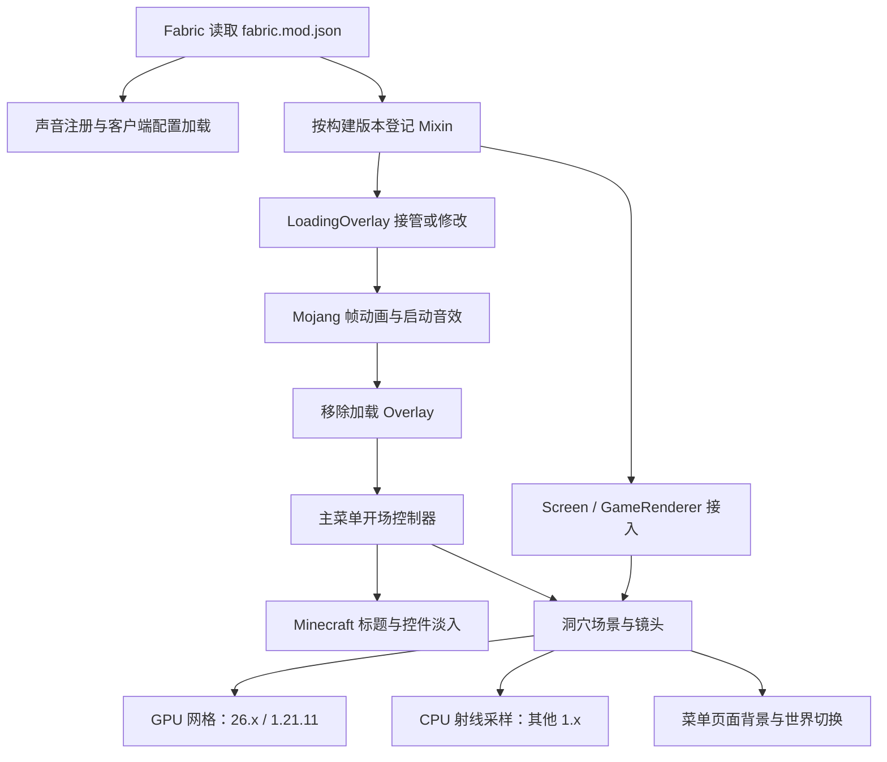

# animated_mojang 项目完整实现逻辑

> 分析日期：2026-10-02（Asia/Shanghai）。
> 分析对象：[chara2015/animated_mojang](https://github.com/chara2015/animated_mojang)，默认分支 `master`。
> 固定提交：[`ef68ffb6d6cdbdfab4db960497719416e8b7a6bc`](https://github.com/chara2015/animated_mojang/commit/ef68ffb6d6cdbdfab4db960497719416e8b7a6bc)，提交信息 `0.01a5`，提交时间 2026-06-25 13:43:36 UTC。
> 本文来自该提交的源码、构建脚本、资源清单和 Mixin 登记文件的静态分析；未编译、未启动 Minecraft。以下“执行流程”表示源码所规定的流程，运行兼容性和最终 JAR 内容另列验证边界。

## 目录

1. [项目实际定位与分析范围](#1-项目实际定位与分析范围)
2. [源码结构与模块分工](#2-源码结构与模块分工)
3. [多版本构建与发布逻辑](#3-多版本构建与发布逻辑)
4. [加载入口、配置与声音注册](#4-加载入口配置与声音注册)
5. [26.x 启动加载画面的完整流程](#5-26x-启动加载画面的完整流程)
6. [Mojang 动画帧与音效同步](#6-mojang-动画帧与音效同步)
7. [主菜单开场与 Minecraft 标题动画](#7-主菜单开场与-minecraft-标题动画)
8. [页面识别、镜头切换与进入退出世界](#8-页面识别镜头切换与进入退出世界)
9. [洞穴数据读取、几何生成与材质](#9-洞穴数据读取几何生成与材质)
10. [GPU 渲染、光照和着色器](#10-gpu-渲染光照和着色器)
11. [火焰、烟雾与遮挡处理](#11-火焰烟雾与遮挡处理)
12. [旧版本实现与反射兼容层](#12-旧版本实现与反射兼容层)
13. [1.21.11 的专用适配](#13-12111-的专用适配)
14. [Mixin 注入点与第三方兼容](#14-mixin-注入点与第三方兼容)
15. [资源、参考资料与未接入的代码](#15-资源参考资料与未接入的代码)
16. [状态、错误处理与实现边界](#16-状态错误处理与实现边界)
17. [按实际调用关系复述完整链路](#17-按实际调用关系复述完整链路)
18. [附录：全部生产 Java 文件索引](#18-附录全部生产-java-文件索引)

## 1. 项目实际定位与分析范围

该项目是 **Minecraft Java 版的 Fabric 客户端模组**。它通过 Mixin 改写游戏已有的加载画面和菜单渲染流程，使用预制动画图集、启动音效及洞穴 schematic 数据，实现连续的启动和菜单背景体验。

它的实现包括：

- Mojang 标志逐帧动画和独立的 STUDIOS 淡入。
- 启动音效延迟播放、重试、视觉时间同步及超时兜底。
- 自定义暗色加载背景。
- 洞穴三维背景、开场镜头运动、点光源与火焰烟雾。
- Minecraft 标题逐帧动画、Java Edition 字样及菜单控件淡入。
- 世界选择、多人游戏、设置、连接、账号等页面的背景复用。
- 多个 Minecraft 版本的源集选择、接口适配和模组兼容处理。

仓库名字是 `animated_mojang`，但源码命名空间、模组 ID、根项目名称为 `labymod_menu`；`ModMetadata.MOD_VERSION` 为 `0.01`，与提交信息 `0.01a5` 不是同一个字段。不能用仓库名或提交信息替代运行时 ID 和构建版本。

当前本地工作区 `F:/MyProject/Minecraft/Animated-Mojang` 是另一个 Git 仓库的 LeviLamina C++ 模板，远程为 `MRUIAW/Animated-Mojang`。本文分析的是用户指定的 Fabric 项目，不把本地的 `MyMod.cpp`、`xmake.lua` 等当作其实现。

固定提交中，排除 `src/test/` 后共有 **133 个文件，其中 80 个 Java 文件**。分析覆盖全部生产 Java 源码、构建和版本配置、Mixin 清单、着色器及资源引用关系。`src/test/` 包含 7,718 个参考/开发工作区文件，不属于当前构建的测试源集；本文按用途解释其与生产实现的关系，不逐个分析其中的第三方代码。

来源：[项目元数据][S01]、[Fabric 模组声明][S02]。

## 2. 源码结构与模块分工

```text
animated_mojang/
├─ build.gradle.kts                 共享构建脚本：源集、依赖、资源展开、JAR
├─ settings.gradle.kts              Stonecutter 目标版本、插件仓库
├─ stonecutter.gradle.kts            当前激活目标 26.1.2
├─ gradle.properties                默认依赖、Gradle/JDK 参数
├─ versions/<version>/              各目标依赖版本和兼容范围
├─ src/main/java/labymod_menu/
│  ├─ ModMetadata                   元数据常量
│  ├─ LabyModMenuMod                通用声音初始化入口
│  ├─ common/                       时间线、数学、镜头参数、屏幕识别
│  ├─ config/                       properties 配置
│  ├─ sound/                        Identifier 时代的声音注册
│  └─ client/LabyModMenuClient       空实现占位，与客户端源集存在同名类
├─ src/main/resources/
│  ├─ fabric.mod.json               Fabric 声明模板
│  ├─ labymod_menu*.mixins.json      Mixin 声明模板
│  └─ assets/labymod_menu/           图集、声音、洞穴、着色器、语言
├─ src/client/java/                 26.x 的动画、控制器、GPU 场景、Mixin
├─ src/client/resources/            另一份现代客户端 Mixin 声明
├─ src/shared_client/java/          通用配置界面和 Mod Menu 接口
├─ src/platform/legacy/client/      1.x 通用旧版实现、反射桥和 Mixin
├─ src/platform/versions/<v>/       版本专用桥、场景策略或 1.21.11 GPU 实现
├─ src/platform/pre_identifier/     备用声音入口，当前脚本未加入该源集
└─ src/test/                        第三方参考项目、开发工作区、LabyMod 参考
```

主要职责分为五层：

| 层 | 主要对象 | 作用 |
| --- | --- | --- |
| 生命周期 | `LabyModMenuMod`、`LabyModMenuClient` | 注册声音、读取配置 |
| 接入层 | 各 `*Mixin` 和 `*Accessor` | 在游戏已有流程中插入、取消或替换行为 |
| 时间/状态层 | `MojangAnimation`、`TitleOpeningController`、`LegacyAnimations` | 动画进度、加载保持、菜单揭示、镜头状态 |
| 渲染层 | `SchematicScene`、`LegacySchematicScene`、`VersionedSchematicScene` | 洞穴解析、网格/射线、光照、粒子绘制 |
| 兼容与资源层 | 各 Bridge、`VersionScenePolicy`、assets | 隔离 API 差异、提供素材和版本策略 |



## 3. 多版本构建与发布逻辑

### 3.1 版本目标

Stonecutter `0.7.10` 建立 11 个版本目标，当前 VCS/激活版本为 `26.1.2`。

| Stonecutter 目标 | 实际 Minecraft 编译版本 | 声明支持范围（原值） | 渲染实现 | Java release |
| --- | --- | --- | --- | --- |
| 1.20 | 1.20 | `>=1.20- <1.20.5` | 通用 legacy / CPU | 21 |
| 1.20.5 | 1.20.6 | `>=1.20.5- <1.21` | 通用 legacy / CPU | 21 |
| 1.21 | 1.21 | `~1.21` | 通用 legacy / CPU | 21 |
| 1.21.1 | 1.21.1 | `~1.21.1` | 通用 legacy / CPU | 21 |
| 1.21.2 | 1.21.2 | `>=1.21.2- <1.21.5` | 通用 legacy / CPU | 21 |
| 1.21.5 | 1.21.5 | `~1.21.5` | 通用 legacy / CPU | 21 |
| 1.21.6 | 1.21.6 | `>=1.21.6- <1.21.11` | 通用 legacy / CPU | 21 |
| 1.21.11 | 1.21.11 | `>=1.21.11- <26` | legacy 动画 + 专用 GPU 场景 | 21 |
| 26.1 | 26.1 | `~26.1` | 现代 GPU 场景 | 25 |
| 26.1.1 | 26.1.1 | `~26.1.1` | 现代 GPU 场景 | 25 |
| 26.1.2 | 26.1.2 | `~26.1.2` | 现代 GPU 场景 | 25 |

这是**构建声明**，不等于已逐版本实测的兼容矩阵。尤其 `1.20.5` 目标实编译 `1.20.6`，并用 `platform_source_version=1.20.5` 保证选择 `1_20_5` 的实现。树中还有 `1_20_6` 的桥文件，但它不是独立构建目标，也不被这个目标默认选择。

### 3.2 构建时的选择过程

1. `settings.gradle.kts` 注册 Fabric、Kikugie、Maven Central 和 Gradle 插件仓库。
2. Stonecutter 建立上述版本子项目。
3. `beforeProject` 读取 `versions/<目标>/gradle.properties`，将非 `[VERSIONED]` 占位值放入 extra properties。
4. 共享 `build.gradle.kts` 读取项目目录下的 properties；`versionedProperty()` 优先使用这个局部值，再查 Gradle 属性。
5. 只有活动目标、明确请求的目标，或请求根生命周期任务时，才完整配置依赖和源集；其他目标停用非 Stonecutter 任务，并清空部分生命周期任务的依赖。
6. 解析 `ModMetadata.java` 中的字符串常量，得到 ID、名称、描述、版本、作者、许可证、链接、JAR 名称和 Maven group。常量匹配失败直接抛出 `GradleException`。
7. 根据 Minecraft 主版本是否 `>=26` 选择现代 Loom 或旧 `fabric-loom`。
8. 为客户端源集加入共享配置界面和所选版本目录。
9. 展开资源模板，编译、打包 sources JAR 和主 JAR。

### 3.3 源集和依赖分支

- **26.x**：保留默认 `src/client/java`，加上 `src/shared_client/java` 和相应 `26_1*` 版本目录；使用 `GuiGraphicsExtractor` 等现代 API。
- **所有 1.x**：客户端 Java 源目录被替换为 `shared_client` 与 `platform/legacy/client/java`，再加所选版本目录；客户端资源使用 legacy Mixin 模板，main 资源排除现代客户端 Mixin 文件。
- **1.20**：排除 `LegacyScreenMixin`，使用 `LegacyScreen120Mixin` 适配旧背景方法签名。
- **其他 1.x**：排除 `LegacyScreen120Mixin`。
- **Identifier 时代**：脚本定义为 `26.x` 或 `1.21.11`，保留 `src/main/java/.../sound`；其他版本排除该目录，由各版本桥注册声音。
- **高级旧版场景注入**：只根据 `advanced_legacy_scene_mixins=true` 开启，不硬编码版本。目前只有 `1.21.11` 设置该属性，登记 GUI accessor、世界背景、列表、过渡页等专用 Mixin。

旧版加入官方 Mojang mappings，Loader/API 使用 `modImplementation`，Mod Menu 使用 `modCompileOnly`；26.x 使用 `implementation` 和 `compileOnly`。Mod Menu 是可选的配置入口，Fabric API 和 Loader 是声明依赖。

所有目标要求 Loader `>=0.19.2`。默认 26.1.2 配置使用 Fabric API `0.150.0+26.1.2`、Mod Menu `19.0.0-alpha.1`。1.21.2 目标的 API 坐标为 `0.107.0+1.21.3`，与 Minecraft 编译版本不同，属于需要构建验证的声明差异。

### 3.4 资源展开和产物

- `fabric.mod.json` 的 ID、版本、作者等由元数据展开，Minecraft 支持范围由目标 properties 展开，Java 要求展开为 21 或 25。
- Mixin 的 compatibility level 展开为 `JAVA_21` 或 `JAVA_25`；legacy/高级场景 Mixin 条目按属性拼接。
- `archivesName` 为 `labymod-menu-<project.name>`，版本为 `0.01`。
- 开启 sources JAR；JAR 重复文件策略为 `EXCLUDE`；LICENSE 以带项目名称的文件名放入 JAR。
- 配置了 `mavenJava` publication，但没有配置发布目的仓库。
- Gradle Wrapper 为 `9.4.1`；根配置硬编码 `org.gradle.java.home=D:/Java/jdk-25`，迁移机器时需替换。
- `sourceSets.test` 的 Java/资源目录置空，`Test` 与 `stonecutterPrepareTest` 任务禁用。`check` 不能被当作有完整自动测试覆盖的证据。
- `fabric_kotlin_version`、`loom_version` 在 properties 中存在，但该共享脚本没有用它们选择 Kotlin 插件或 Loom 版本；实际 Loom 声明直接写在 plugins 中。

来源：[构建脚本][S03]、[版本目标与属性注入][S04]、[激活版本][S05]、[各版本配置目录][S06]。

## 4. 加载入口、配置与声音注册

### 4.1 Fabric 入口

`fabric.mod.json` 声明：

- `environment: client`：整个模组只在客户端加载。
- `main`：`labymod_menu.LabyModMenuMod`。
- `client`：`labymod_menu.client.LabyModMenuClient`。
- `modmenu`：`labymod_menu.client.config.ModMenuIntegration`。
- 通用与客户端 Mixin 配置；通用配置的 `mixins` 数组为空。
- `breaks.animated_mojang="*"`：声明与 ID 为 `animated_mojang` 的另一个模组冲突，自己的 ID 是 `labymod_menu`。

通用初始化入口先反射调用 `ModSounds.initialize()`。调用会触发 `ModSounds` 的静态字段初始化，将 `labymod_menu:startup` 注册到声音注册表。若 `ModSounds` 类不存在，再调用当前版本的 `IdentifierAnimationBridge.registerSounds()`。找不到类表示尝试另一条路径；其他反射异常被包装为 `IllegalStateException`。

客户端入口读取配置；现代实现另设置 `initialized=true`，两条客户端实现都会记录初始化日志。main 目录还有同名空客户端入口，见第 16 节的源集边界。

### 4.2 配置读写

配置路径为：

```text
<FabricLoader 的 config 目录>/labymod_menu.properties
```

| 键 | 默认值 | 生效逻辑 |
| --- | --- | --- |
| `mojangLogoAnimation` | true | 是否接管 Mojang 加载动画 |
| `darkLoadingScreen` | true | 是否使用 `0xFF14181C` 暗色背景 |
| `minecraftTitleAnimation` | true | 是否绘制标题动画、隐藏/渐显菜单控件 |

读写机制：

1. `load()`、`save()` 为 synchronized 静态方法。
2. `load()` 利用 `loaded` 只读一次文件，标志在 I/O 前设为 true。
3. 文件存在时读取 Java `Properties`；`IOException` 被忽略。
4. 缺少键用默认 true；键存在则用 `Boolean.parseBoolean`，所以任意非“true”文本会变成 false。
5. getter 和 setter 都先调用 `load()`；setter 只修改内存。
6. `save()` 创建父目录，并重新写出三个键，不保留未知扩展键；写入异常同样被忽略。

配置文件不存在时不会仅因 `load()` 自动创建；需调用保存。运行中手改文件也不会自动重载。

### 4.3 配置界面与声音素材

`ModMenuIntegration` 返回 `LabyModMenuConfigScreen::new`。界面以父 Screen 为返回目标，有三个 200×20 开关按钮和“完成”按钮，依次切换内存布尔值、更新按钮文本；`onClose()` 保存配置后返回父界面。文本由 `en_us.json` / `zh_cn.json` 和原版 `options.on/off` 提供。

`sounds.json` 将事件 `startup` 指向 `labymod_menu:startup`，实际文件为 `sounds/startup.ogg`。播放使用 UI 声音实例，参数音高为 1.0；4066 ms 的时长来自代码常量，没有运行时解析 OGG 时长或监听播放结束。

来源：[通用入口][S07]、[配置实现][S08]、[共享配置界面][S09]、[声音注册][S10]。

## 5. 26.x 启动加载画面的完整流程

### 5.1 纹理和背景准备

`LoadingOverlayTextureMixin` 在原版 `LoadingOverlay.registerTextures` 尾部注册 Mojang 图集与 STUDIOS 图。纹理使用 `ClasspathTexture`，从 JAR classpath 的 `assets/<namespace>/<path>` 直接读取 `NativeImage`，不经传入的 ResourceManager 查找。素材不存在时抛出 `IOException`。

`LoadingOverlayMixin` 在 `LoadingOverlay.<clinit>` 完成后，把 `BRAND_BACKGROUND` 替换成一个包装的 `IntSupplier`。每次求值检查暗色配置；开启时为 `0xFF14181C`，关闭时调用原供应器，所以即使关闭 Mojang 动画，暗色背景开关仍可影响原版加载画面。

### 5.2 每一帧的接管条件和步骤

注入 `LoadingOverlay.extractRenderState` 的 HEAD：

- 如果 Mojang 动画关闭，立即返回，保留原版逻辑。
- 如果该 Overlay 的 `fadeIn=true`，也立即返回，保留这类重载的原版逻辑。
- 其余情况取消原方法，执行自定义绘制和加载完成控制。

自定义分支依次执行：

1. 取 `Util.getMillis()`。
2. 处理淡入起点辅助方法；由于入口已排除 `fadeIn=true`，这个入口里其淡入分支不会实际触发。
3. 平滑 `currentProgress`，reload 完成时目标为 1：
   `new = old * (1-s) + target * s`。动画完成前 `s≈0.05`，完成后 `s=0.12`，最后 clamp 到 0..1。
4. **仅当 `reload.isDone()` 才首次启动 Mojang 动画**；此前显示原版静态 Mojang 标志。
5. 动画未完成时将已有 `fadeOutStart` 重置为 -1，保持加载覆盖层。
6. 填充背景，绘制动画或原版标志，再绘制进度条。
7. reload 完成后，用实例布尔值保证加载完成回调只处理一次。
8. 动画完成且回调已处理后，设置淡出起点。
9. 下一些帧满足淡出进度 `>=1` 且动画结束时，调用 `Minecraft.setOverlay(null)`，然后尝试 `TitleOpeningController.playOpening()`。

这里有两个独立条件：“资源加载完成”和“展示动画完成”。动画在资源完成后启动，而资源完成回调不必等完整动画播放结束。

### 5.3 加载完成、错误和 Overlay 移除

`finishReload()` 调用 `reload.checkExceptions()`：

- 正常：`onFinish.accept(Optional.empty())`。
- 捕获 Throwable：`onFinish.accept(Optional.of(throwable))`。
- 接着设置 `reloadFinished=true`，若当前 Screen 非空，按 GUI 尺寸重新 init。

自定义分支还取消原版 `LoadingOverlay.tick()`，避免原 tick 自行提前移除 Overlay。关闭动画时，TAIL 注入会在非 fadeIn 加载结束且 Overlay 已为空后尝试启动主菜单开场。

**代码中的“淡出”主要是移除等待**：`fadeOutProgress=(now-start)/1000`，达到 1 后就移除 Overlay。当前自定义背景和标志仍全强度绘制；进度条 alpha 用 `1-clamp(fadeOut-1)`，在达到移除阈值前仍为 1。因此不能把它描述成已经实现完整的 1 秒全屏透明度渐变。

来源：[加载画面 Mixin][S11]、[字段 accessor][S12]、[classpath 纹理][S13]。

## 6. Mojang 动画帧与音效同步

### 6.1 图集拆帧

`MojangAnimation` 使用这些常量：

| 项目 | 值 |
| --- | --- |
| 帧数 / 每帧时间 | 79 / 40 ms，目标帧率 25 fps |
| 单帧画布 | 600×129 |
| 图集排列 | 10 列 × 8 行，逻辑尺寸 6000×1032 |
| 标志裁切区 | (31,31)，540×83 |
| 标志淡入 | 300 ms |
| 标志帧动画时长 | 3160 ms |
| STUDIOS 裁切区 | (30,18)，506×56，源图逻辑尺寸 560×90 |
| STUDIOS 开始 / 淡入 | 3160 ms / 400 ms |
| 音效开始 / 重试间隔 | 350 ms / 200 ms |
| 音效长度常量 / 尾部等待 | 4066 ms / 450 ms |
| 基础总展示时间 | 4866 ms |
| 等音效超时兜底 | 从 `startedAt` 算 8000 ms |
| 每次渲染最大视觉推进 | 50 ms |

帧号为 `min(visualElapsed/40,78)`；横向坐标为 `(frame%10)*600+31`，纵向为 `(frame/10)*129+31`。达到最后一帧后停留，不循环。

### 6.2 视觉时间不是直接墙钟时间

`start()` 是一次性状态初始化，已 started 则不重置。`animationElapsed()` 以每次 render 的墙钟差累计视觉时间：

```text
delta = max(0, now - lastRenderAt)
visualElapsed += min(delta, 50 ms)
```

首次 render 只记录时间，不推进。这样长时间卡顿不会一次跳过很多帧，但低帧率下实际播放时长也会长于理想的 4866 ms。

音效同步逻辑：

1. 视觉时间没到 350 ms 时不尝试声音。
2. 到达后播放 `SimpleSoundInstance.forUI(STARTUP,1.0F)`。
3. `SoundEngine.PlayResult != NOT_STARTED` 即视为启动成功；不额外区分其他返回值。
4. 成功后释放视觉保持，并把视觉时间重置为 350 ms，使后续视觉从声音启动位置继续推进。
5. 未成功且还没到重试间隔时，将视觉时间固定回 350 ms。
6. 未成功时每隔 200 ms 再试；距离 start 达到 8 秒后设置 released，允许动画继续，即使没有声音。
7. `isFinished()` 按视觉时间判断，取总展示时长、声音时间常量和 STUDIOS 淡入结束的最大值。

`soundStartedAt` 被赋值但不参与结束条件；这个机制不是根据实际音频播放游标同步。声音起点/视觉累计、卡顿限制和 8 秒兜底一起决定真实等待时间。

### 6.3 屏幕布局

先取 `vanillaHeight = min(guiWidth*0.75,guiHeight)*0.25`，标志宽度为其 4 倍；实际标志高度按裁切区宽高比计算，水平居中，向上偏移约 `vanillaHeight*0.16`。STUDIOS 高度为 `vanillaHeight*0.2`，按自己的裁切宽高比缩放，位于标志下方。透明度打包到 ARGB 后经 `GUI_TEXTURED` 绘制。

`renderPreview()` 可以画全不透明的第 0 帧，但当前生产调用没有把它作为设置页预览接入。

来源：[MojangAnimation][S14]。

## 7. 主菜单开场与 Minecraft 标题动画

### 7.1 启动条件和时间线

现代 `TitleOpeningController.playOpening()` 满足以下条件才启动：

- 还没有播放过开场。
- 当前没有 Overlay。
- 当前 Screen 是 `TitleScreen`。
- Mojang 动画关闭、尚未开始，或已经结束。

启动时预加载九张 Minecraft 动画纹理，设置 `openingPlayed` 和 `openingStartedAt`。它也会从 TitleScreen 的背景/GUI 注入点反复被调用，但布尔状态保证进程内只启动一次。

以主菜单开场起点为 0：

| 时间 | 行为 |
| --- | --- |
| 0..4000 ms | 镜头沿洞穴开场轨迹移动 |
| 0..2700 ms | 开启标题动画时隐藏菜单控件，拦截该主菜单的 mouseClicked |
| 1880 ms | Minecraft 标题帧动画开始 |
| 2700..3200 ms | 菜单控件从 alpha 0 渐显到 1 |
| 3200 ms 后 | 第三方后置覆盖层允许显示 |
| 4000 ms 后 | 开场镜头完成，开始常规页面镜头状态 |
| 从 1880 ms 起约 2760 ms | 69 帧标题素材的名义播放区间；末帧进入后保持 |

69 帧每帧 40 ms，最后一帧实际在相对标题开始的 2720 ms 时就被选中；“2760 ms”是以每帧完整时长计算的总名义时长。因此标题动画可以在 4 秒镜头开场结束后继续到末帧。

现代逻辑的 `shouldHideTitleWidgets()` 还检查 `isOpeningPlaying()`，所以开场完成后 alpha 直接回 1。Java Edition 则乘以时间线的菜单 alpha，从菜单揭示时开始显示。

### 7.2 轨迹、缓动与遮罩

`OpeningTimeline` 定义 4 秒、2700 ms 揭示、500 ms 淡入。缓动为 cubic-bezier `(0.2,0.32,0.2,1.0)`，通过二分 x 找参数 t 后求 y；共享数学实现使用 14 次二分，现代控制器的本地实现用 12 次。

镜头的 x/y/z/yaw/pitch/roll 六个分量，各自经过三个关键点的自然三次样条：

```text
OPENER_START    (17, 13, 82,   0,   0, -90)
OPENER_TRANSFER (20,12.8,44,   8,  -5, -10)
TITLE          (31, 13,  6,  21, -13,   0)
```

先按贝塞尔曲线得到进度，再沿两段样条取值，使镜头从远处、较大滚转逐渐进入最终构图。渲染器额外根据时间和距标题镜头 z 的距离叠加轻微 y/yaw/pitch/roll 摆动。

`renderFadeCover()` 以黑色遮罩渐减：alpha 为 `max(0,0.48-transitionProgress*0.52)`；transitionProgress 取镜头缓动和指数形式的渐隐进度中较大者。它与加载 Overlay 的移除等待是两段不同的流程。

### 7.3 标题素材的定位

`AnimatedMinecraftTitle` 有 9 张纹理，每张按 8 个纵向帧处理：

- 每帧逻辑画布 2403×749，每张纹理逻辑高度 5992。
- 帧号夹在 0..68，纹理索引 `frame/8`，行号 `frame%8`。
- 最终内容定位参数为 x=518、y=502、宽=1373。
- 目标 Minecraft 字样宽 256；缩放 `min(1,guiWidth*0.90/256)`。
- 根据最终内容宽度计算整个素材画布的缩放，把最终字样对齐到原版水平居中和顶端 y=30 的布局，而不是把整张大画布直接居中。
- Java Edition 使用原版 `textures/gui/title/edition.png`，目标 128×14；位置为 `30+(44-7)*scale`，独立绘制和淡入。

`TitleScreenMixin` 的 HEAD 在隐藏阶段自行提交背景效果、标题和遮罩，然后取消原 Screen 绘制。显示阶段继续原版控件流程，但替换 LogoRenderer 调用、修改 fadeWidgets 的 alpha；`ScreenMixin` 也处理新加 widget 和直接 renderable 的 alpha，避免某些控件绕过主菜单淡入。

**开关边界**：现代控制器即使关闭 `minecraftTitleAnimation` 也仍能启动洞穴开场并设置 `openingPlayed`；该开关控制标题和菜单显示逻辑，不是全局“关闭洞穴背景”开关。现代仅显式拦截主菜单的鼠标点击，不能描述为全部键盘/滚轮输入都被统一屏蔽。

来源：[开场控制器][S15]、[共享时间线][S16]、[标题帧动画][S17]、[主菜单注入][S18]。

## 8. 页面识别、镜头切换与进入退出世界

### 8.1 哪些界面使用动态背景

现代控制器先判断世界状态，再判断具体 Screen：

- 有 `minecraft.level` 且不是过渡 Screen 时，停止洞穴背景，清除连接流程并记录 `wasInWorld`。
- 从这种世界状态回到菜单/过渡界面时，设置返回状态和最少 3000 ms 镜头过渡。
- 连接流程激活时，持续允许动态背景。
- Title、世界选择/创建、多人列表、服务器管理/直连、连接/断开、加载/等待/进度、选项/资源包等明确类型允许。
- 对第三方界面，再用 `DynamicBackgroundScreens.matches()` 做类名匹配。

匹配关键词包含 `Title`、`World`、`Multiplayer`、`Server`、`Options`、`Pack`、`Connect`、`Disconnected`、`Loading`、`Progress`、`Waiting`、`Message`、`Realms`、`Mod`、`Config`、`Create`、`GameRules`、`Experiments`、`DataPack`、`Account`、`Replay`、`AltManager`、`AltScreen`、`Switcher` 等；完整类名包含 realms/modmenu/ConfigScreen 等也允许。

该匹配是启发式字符串识别，不是通过第三方注册一个统一接口。账号/Replay 辅助识别则使用转小写后的完整类名。

### 8.2 镜头参数和目的地

各姿态分量依次为 x、y、z、yaw、pitch、roll：

| 场景 | 姿态 |
| --- | --- |
| 主菜单 | (31,13,6,21,-13,0) |
| 单人世界 | (23,17,15,-31,7,5) |
| 多人列表 | (23,13,15,-31,-13,5) |
| 设置/资源包 | (23,13,15,-15,-13,-5) |
| 账号 | (18,13,18,10,0,1) |
| 管理服务器/直连 | (23,13,18,-21,-13,8) |
| 连接/断开/连接流程 | 开场起点 (17,13,82,0,0,-90) |
| 现代 Replay 识别 | 使用单人姿态 |
| 未专门匹配的动态界面 | 保持已有 transitionTargetCamera |

现代切换由 `screen.getClass()!=lastScreenClass` 或返回世界标志触发。同类 Screen 实例之间切换不会自动重设镜头。

切换时先算出旧过渡当前时刻的姿态，再复制为下一次过渡起点，复制目标姿态，记录开始时间；这样中途切换页面不会从旧起点跳变。普通切换 500 ms，连接/断开及某些加载返回多人列表流程为 3000 ms。退出世界时从 OPENER_START 重新进入，采用 `6t^5-15t^4+10t^3` smootherstep。

### 8.3 连接流程与 GUI 合成

进入 `ConnectScreen` 设置 `connectionFlowActive=true`。只在返回明确菜单出口时清除，例如主菜单、多人列表、直连、服务器管理、世界选择/创建、选项；连接途中经过未知等待界面，保持连接镜头。

现代 `GameRendererMixin` 在 GuiRenderer 真正绘制 GUI **之前**调用 `renderWorldBackground()`，把三维洞穴先画到主目标；Screen 注入取消原版 panorama/background，前景 GUI 保持原版。

对非主菜单且非设置类的动态界面，Screen 背景替换会调用 `blurBeforeThisStratum()`；TransitionScreen 注入也会请求模糊。主菜单/其他页面的粒子效果在 GUI 提交阶段单独绘制，以此前三维渲染记录的镜头做投影。

来源：[现代背景控制器][S15]、[镜头参数][S19]、[第三方屏幕识别][S20]、[GameRenderer 注入][S21]。

## 9. 洞穴数据读取、几何生成与材质

本节说明现代 `SchematicScene`；1.21.11 的 `VersionedSchematicScene` 具有相同核心算法，旧 CPU 分支的差异见第 12 节。

### 9.1 惰性加载及数据组织

`get()` 首次从 classpath 读取 `assets/labymod_menu/data/normal_cave.schem`，用 `NbtIo.readCompressed` 和 unlimitedHeap accounter 解析 NBT。只选择正常洞穴，当前没有冬季洞穴切换条件。

读取 Width、Height、Length（short，兼容 int）、Palette、BlockData，以及可选 BlockLight / BlockLightRed / Green / Blue。Palette 中“状态字符串 → ID”被转换为“ID → 状态字符串”数组，数组长度按最大 ID+1 构造。

`BlockData` 用 7 位组 VarInt 解码，期望数量为 `width*height*length`。编码移位超过 28 位、数量不足或尾部半个 VarInt 会抛出异常；达到期望数量后停止处理，因此并非所有额外尾部字节都被拒绝。

一维索引：

```text
index(x,y,z) = x + z*width + y*width*length
```

对每个索引维护状态、基础光和 RGB 光数组，再收集壁面/细节采样、MeshFace、LightPoint、TorchSample。加载缺文件、I/O 或运行时异常会返回 1×1×1 的 EMPTY 场景，并缓存结果，不会继续每帧重试加载。

### 9.2 材质筛选

现代保留代码白名单中的材质，主要是石头、草方块、橡木、圆石、矿石、工作台、熔炉、泥土、沙砾、火把/灵魂火把、岩浆、蛛网、草/花、栅栏、铁轨、台阶、萤石，以及雪、冰、南瓜、拉杆。未知方块不会自动交给 Minecraft 原版模型渲染器，而是被跳过。

各版本 `VersionScenePolicy` 表示不可见方块。26.x 策略排除 null、包含 `:air` 的状态及 barrier；1.21.11 额外显式排除 cave_air/void_air。legacy 的 CPU 类使用自己的 `supported()` 筛选，虽然树中有对应 legacy VersionScenePolicy，其方法没有被 CPU 场景调用。

### 9.3 几何构建与可见面

逐方块生成六个方向面，按相邻状态剔除内部面，并处理以下特殊情况：

- 完整不透明邻接方块：内部面不生成。
- 岩浆：相邻岩浆保留侧向面；被完整实体邻接阻挡的面不生成。
- 冰邻接冰、同类雪层、同类型台阶、上下邻接栅栏：有专门剔面规则。
- 铁轨：仅生成朝上的薄面。
- 草、花、蛛网：交叉平面，并补反向顶点顺序，形成双面素材。
- 台阶：bottom/top/double 决定 y 范围。
- 栅栏：现代方块几何以中心柱的包围盒生成；粒子遮挡另外计算连接横杆，不能把它描述成已完整生成所有栅栏横杆网格。
- 火把：细长盒；按 facing 旋转墙上火把顶点。
- 雪：高度为 layers/8。
- 岩浆：依据本方块 level、上方岩浆和四周 level 调整四个顶角，确定流动顶面的倾斜与纹理旋转。

几何是针对本背景素材手工实现的简化形状集合，不能等同于完整 BlockState→原版 baked model 系统；例如材质白名单包含拉杆，不代表它有完整原版拉杆模型。

### 9.4 UV 和顶点颜色

方块图集逻辑尺寸 256×256，每格 16×16。普通材质用 tileFor；草方块、工作台、熔炉、南瓜按面法向和 facing 选不同 tile。火把、半砖、栅栏再裁切 UV。铁轨 shape 和岩浆流向决定纹理顶角顺序。

岩浆图集为 32×512，32 帧，每帧取 16 像素高度；帧号为 `floor(time*1000/300)%32`，静止顶部强制取第 0 帧。

顶点先根据邻域基础光计算亮度，草等材质再叠加固定色调。真正的方向阴影由顶点着色器生成；`materialColor()` 接收 directionShade 和 fog 参数，但当前并未把它们用于结果计算。

### 9.5 数据对象

- `MeshFace`：四顶点位置/UV、法向、状态、光照、岩浆标记。
- `LayerMesh`：GPU 顶点缓冲与索引数。
- `LightPoint`：世界位置、RGB、constant/linear/quadratic 衰减。
- `TorchSample`：发射位置、朝向、hash、熔炉/灵魂标记。
- `CameraPose`：位置、镜头轴及 viewMatrix。
- `SceneBlocks`：解码过程的全部数组和生成对象列表。
- `ProjectedFace` / `MeshRenderState`、RayHit、RenderCell：备用 GUI 投影/射线绘制路径的数据对象。

来源：[现代洞穴渲染器][S22]。

## 10. GPU 渲染、光照和着色器

### 10.1 主渲染路径

实际主调用是：

```text
GameRendererMixin
  → TitleOpeningController.renderWorldBackground()
  → SchematicScene.get().renderDirectAt(...)
  → renderDirect(CameraPose,time)
```

每帧步骤：

1. 记录镜头，用窗口实际像素宽高计算渲染目标大小；零尺寸时返回。
2. 使用固定 LABY_RESOLUTION=5：
   `resolutionFactor=1+(10-5)/9≈1.5556`，内部宽高约为窗口的 64.3%，像素数约为 41.3%。
3. 尺寸变化时 resize 独立的有深度 `TextureTarget`。
4. 确保静态实体层、cutout 层及岩浆层网格已建好。
5. 选取最多 48 个光源，并上传 Schematic UBO。
6. 清空离屏目标颜色与深度。
7. 构造 50° 透视，near=0.05、far=1024；备份原投影，设置当前投影和 DynamicTransforms。
8. 同一 render pass 依次绘制 solid、lava/translucent、cutout，绑定材质纹理、顶点缓冲、顺序 QUADS 索引缓冲和 UBO。
9. finally 恢复原投影矩阵。
10. 用全屏三角形和 LINEAR sampler 将离屏颜色放大到主 RenderTarget。
11. 原版 GUI 随后在主目标上绘制。

静态层通常只构建一次。岩浆每 8 个 20 Hz tick 重建一次，约 400 ms；纹理时间常量是 300 ms，所以实际更新由网格重建频率量化，不能视为每 300 ms 准时刷新。重建前关闭旧岩浆顶点缓冲。

### 10.2 渲染管线

| Pipeline | 行为 |
| --- | --- |
| SOLID | 自定义 cave shaders，默认深度状态 |
| CUTOUT | 同 shaders，定义 ALPHA_CUTOUT=0.5 |
| TRANSLUCENT | ALPHA_CUTOUT=0.01，透明混合，深度比较 <=，关闭深度写入 |
| LINEAR_BLIT | 原版 screenquad/blit_screen，全屏三角形，线性放大离屏颜色 |

网格格式是 `POSITION_TEX_COLOR_NORMAL`。现代与 1.21.11 的管线状态 API 写法不同，但以上目标行为基本一致。

### 10.3 基础光解析与传播

解码开始会读取 RGB 光数组，但随后调用 `resolveEmbeddedDefaultLegacyLight()`，把同一套**默认灰度光**覆盖到基础光、R、G、B 数组。当前生产链路并未启用 `propagateColoredLegacyLight()` 的分色传播。

默认光两条路径：

- 嵌入 BlockLight 长度等于方块体积：把每个 byte 当 level；负值表示待求位置，放入队列，用自身发光值、透明基础值和六邻居 level-1 反复更新受影响位置。
- 长度不等：从发光方块开始 BFS 向六邻居传播，每步减 1；透明位置基础为 1。

发光值：亮熔炉为 13，火把、岩浆、萤石等为 15。注意 `propagateNeighbor()` 没有按实心材质阻断传播，因此不能把它概括成完整复刻原版光照引擎。

顶点亮度检查其邻接的 2×2×2 位置，结合透明/发光规则取得平均 level，再映射为 `clamp((0.06*level+0.1)*2,0,1)`。这里的 2 是固定 LABY_BRIGHTNESS。

### 10.4 点光源与 UBO

光源从方块状态收集：

| 来源 | RGB | 衰减 (constant,linear,quadratic) |
| --- | --- | --- |
| 普通火把 / 亮熔炉 | (0xCC,0x66,0)/255 | (0.12,0.20,0.256) |
| 灵魂火把 | (0x0A,0x56,0xA5)/255 | (0.12,0.20,0.256) |
| 萤石 | (1,1,1) | (1,0.045,0.0075) |
| 部分岩浆方块 | (1,0.44,0.05) | (1,0.35,0.44) |

岩浆候选条件为 x、y、z 任一坐标能被 4 整除，并非只取“每 4 方块一个”的单维规则。光源按 `dx²+dz²+100*dy²` 排序，选最优 48 个，即对高度差给予很高权重。每帧排序并上传，空位以 inactive 光源填充。

UBO 按 std140 放置 enabled、48 个位置、颜色和三套标量衰减数组，大小 `16+48*16*5=3856` bytes。

### 10.5 Shader 最终颜色

顶点 shader：

- `gl_Position = ProjMat * ModelViewMat * vec4(Position+ModelOffset,1)`。
- x 法向亮度系数 0.6，y 法向 1.0，z 法向 0.8。
- 输出 UV、顶点色和 worldPosition。

片元 shader：

1. 采样纹理并乘 ColorModulator。
2. 若定义 ALPHA_CUTOUT，先按纹理×顶点 alpha 丢弃。
3. 遍历有效点光源，使用
   `attenuation=1/(constant+linear*d+quadratic*d²)`。
4. 将各点光 RGB 相加，与顶点色和纹理相乘。
5. 最终 alpha<0.1 时丢弃，否则输出。

点光计算没有检测方块遮挡，也没有 shadow map；粒子的遮挡算法不适用于点光。片元光照相加没有显式 clamp 或色调映射，最终亮度受渲染目标格式影响。

### 10.6 保留的备用绘制路径

`SchematicScene.render()` 可将面投影为 GUI 四边形：按屏幕尺寸/48 桶镜头缓存、背面和屏外筛选、深度从远到近排序，再提交 GuiElementRenderState。类内还保留 CPU 射线缓存和简化 BlockSample 绘制方法。

这些方法与 **legacy 实际使用的 CPU 渲染器不是同一个对象**。现代控制器主路径使用 renderDirectAt，没有调用 render()、buildRenderCache() 或 renderSamples()，不能把备用路径当作默认生产输出。

来源：[场景渲染器][S22]、[管线定义][S23]、[顶点 shader][S24]、[片元 shader][S25]。

## 11. 火焰、烟雾与遮挡处理

现代/1.21.11 场景从火把、灵魂火把和亮熔炉建立发射器。火把位置为方块中心附近 y+0.7，并按墙面 facing 偏移；熔炉从正面边缘发射，竖向和横向带随机偏移。

更新逻辑：

- 以 `time*20` 取粒子 tick，每帧最多补算 4 tick，防止卡顿后大量追赶。
- 首次为距镜头 72 方块内的普通/灵魂火把预种粒子。
- 火把每 5 tick、熔炉每 8 tick 生成一次；利用方块位置 hash 打散时序。
- 一次生成火焰与烟雾；生命周期、运动和尺寸随机。
- 火焰速度逐步乘 0.95；烟雾额外有向上加速度，并按年龄切换 8 帧烟雾贴图。
- 粒子超龄就删除。现代类没有旧版的 384 粒子硬上限。

绘制时用最近一次 renderDirect 记录的镜头，按相同 50° 透视投影；拒绝镜头后方、depth>92、明显屏外的粒子。粒子尺寸与 GUI 高度成正比、与深度成反比，并按生命周期缩小。

遮挡分两级：

1. 普通情形：从镜头到粒子以每方块约 16 个采样点检查方块；忽略发射源自身方块，完整实心方块会遮挡。
2. 发射源周围 ±2 方块范围存在蛛网/栅栏：启用部分遮挡，对 billboard 每个屏幕像素转换到世界坐标、逐像素射线判断，仅绘制可见像素。蛛网用对角薄面近似；栅栏按中心柱、连接方向和两段横杆高度判断。

粒子仍以 GUI blit 画在三维背景上，手工射线判断是其主要空间遮挡保障，不是由粒子网格直接写入背景深度缓冲。

现代控制器另有 `drawParticles()` 生成 28 个细小暖色漂浮点；这属于二维装饰粒子，与基于方块发射的火焰/烟雾不同。当前主菜单背景效果调用它，其他菜单的动态效果主要绘制场景火焰/烟雾。

来源：[场景粒子与遮挡][S22]、[现代背景效果][S15]。

## 12. 旧版本实现与反射兼容层

### 12.1 LegacyAnimations 的加载和标题状态

旧版将 Mojang、STUDIOS、标题帧动画集中到 `LegacyAnimations`，帧数、裁切、音效等待、菜单时间线与现代基本一致，但接管加载的时机不同：

1. `LegacyLoadingOverlayMixin` 在 `LoadingOverlay.render` HEAD 且 Mojang 动画启用时接管。
2. 当前 Overlay 实例的首次 render 调用 `beginLoading()`，立即启动动画；**不等待 reload 完成，也未排除 fadeIn Overlay**。
3. 每帧绘制 LegacyAnimations.renderLoading；整个原版 render 被取消。
4. 同时满足动画结束和 `reload.isDone()` 时请求 `setOverlay(null)`。
5. `LegacyMinecraftOverlayMixin` 统一拦截“移除 Overlay”：动画未结束就取消，结束则标记 finishLoading。
6. 主菜单 `added/render` 尝试 startTitle；需无 Overlay、当前是 TitleScreen，且加载已结束、尚无加载动画或动画已完成。
7. titleStartedAt 只在首次设置。beginLoading 会重置它及声音/视觉状态，所以旧版后续资源重载也可能重走此链路。
8. titleStartedAt 建立后，通过版本桥启动世界背景；如果桥无 GPU 实现，则使用 CPU 场景。

旧版声音以 350 ms 视觉点保持，200 ms 重试、8 秒兜底，视觉推进最大 50 ms。早期桥的声音 API 返回 void，桥调用 play 后直接返回 true，无法判断实际播放是否启动；1.21.11 使用 PlayResult 才能精确区分 NOT_STARTED。

旧版 `LegacyTitleScreenMixin` 在开关启用时开始标题状态，隐藏阶段取消原主菜单 render，并绘制背景/粒子/标题；其他阶段更新子 widget alpha，再替换原版 panorama 和 LogoRenderer。它没有现代版显式 mouseClicked 拦截。

### 12.2 旧版 CPU 洞穴渲染

早期版本 `IdentifierAnimationBridge.renderScene()` 直接返回 false，因此使用：

```text
LegacyAnimations.renderScreenBackground()
  → LegacyIdentifierBridge.renderScene() 返回 false
  → LegacySchematicScene.get().render(...)
```

CPU 场景实现：

1. 通过 GZIPInputStream + DataInputStream 自行解析 NBT 标量、字节数组、list、compound、int/long 数组，避开各版 NBT API 差异。
2. 按 Palette/VarInt/索引公式取得状态；使用自己的较宽字符串材质筛选。
3. 嵌入光数组恰好等于体积时用 `max(0,byte)/15`，否则用 `lightFor(state)`；不采用现代 BFS 重解负值。
4. 根据页面名称选 CameraProfiles。主菜单用两段 smoothstep 插值近似三个关键点，其余界面直接切到固定姿态；**普通 legacy 没有现代 500 ms / 3000 ms 页面间插值状态机**。
5. 将屏幕按 3..6 像素步长采样，为每个 cell 发射一条视线。
6. 先求视线与洞穴整体 AABB 的交区间，再用 DDA 在方块网格中沿 x/y/z 的最近边界推进，最多到 96 方块范围。
7. 命中材质后按命中面与局部坐标选择图集 UV。栅栏/交叉素材有简化形状判定。
8. 按命中距离和方块光计算灰度与雾衰减，再用 GUI blit 绘制 cell。
9. 相同屏幕大小/量化镜头 hash 复用 cell 列表，避免每帧重新射线采样。
10. 后画火把/熔炉烟雾和火焰，20 Hz 更新、最多追赶 4 tick、上限 384 粒子，使用较简化的射线遮挡。

岩浆 UV 在 **重建 cell 缓存时**按墙钟 400 ms/帧取值；缓存失效只看屏幕尺寸和镜头，不包含时间。固定镜头下这条路径的岩浆动画可能冻结，不能把它写成已持续每帧更新。

旧版支持白名单比现代简化，不包含完整冬季材质能力；台阶/铁轨等也不是现代网格的精细几何。

### 12.3 LegacyRenderBridge 的接口适配顺序

优先寻找所选版本的 `IdentifierRenderBridge.location/blit`；目前 1.21.11 提供这组直接调用。若不存在：

1. 借 Fabric MappingResolver，将 intermediary `class_2960` 映射到运行时资源标识类；再尝试 Identifier/ResourceLocation 名称。
2. 寻找静态 `(String,String)→标识类` 工厂，或二参数构造器。
3. 寻找可用 GuiGraphics blit 重载：
   - 13 参数，首参为 RenderPipeline。
   - 13 参数，首参为 RenderType 的 Function。
   - 11 参数，首参为纹理标识。
4. 从 mapped 字段/名称取得 GUI_TEXTURED pipeline，或找到 RenderType 工厂。
5. 缓存反射句柄，后续 blit 复用。
6. 未找到可用接口或调用失败时抛 IllegalStateException；这里没有静默“画不出来就忽略”的兜底。

11 参数路径不能传入末尾 color，因此旧 API 下传入的动画 alpha/tint 不一定体现为与新版本完全相同的效果。反射方法主要按签名筛选，而非唯一方法名，存在运行时选中不同兼容重载的验证需求。

### 12.4 LegacyIdentifierBridge 与暗色兼容

LegacyIdentifierBridge 缓存对各版本 IdentifierAnimationBridge 的方法：

- preload、registerSounds（由通用入口调用）、playStartupSound。
- useLightLoadingBackground、suppressMenuMusic。
- startWorldBackground、renderScene、renderEffects、hasVersionedScreenEffects。

桥方法找不到或反射调用失败通常返回 false/忽略，允许落回 CPU 路径或等待声音兜底。

早期版本的 `useLightLoadingBackground()` 为 false；关闭自定义暗色时，LegacyCompatibility 尝试读取 `dark-loading-screen` 模组公开的 config.backgroundColor，成功则保留其 RGB，失败或未安装时用 `0xFF050509`。1.21.11 的桥返回 true，关闭暗色时动画分支用 Mojang 红色 `0xFFEF323D`。

旧版 MusicManager Mixin 在标题开始前取消 tick；LegacyAnimations 还会在加载动画未完时通过桥停止已有菜单音乐。其条件与“直到菜单控件完全显示”并不完全等价，实际主要围绕加载未完和 titleStartedAt 未建立。

来源：[LegacyAnimations][S26]、[CPU 洞穴场景][S27]、[GUI 反射桥][S28]、[旧版客户端目录][S29]。

## 13. 1.21.11 的专用适配

1.21.11 在构建上仍走 legacy 源集，但开启 `advanced_legacy_scene_mixins=true`。其构成是：

- 启动/标题时间线：LegacyAnimations。
- 纹理、声音直接 API：版本自己的 IdentifierAnimationBridge / IdentifierRenderBridge。
- 三维场景：VersionedSchematicScene。
- 镜头状态：VersionedTitleBackgroundController。
- 原版 GUI 接入：五个高级 Mixin 和 GUI accessor。

VersionedSchematicScene 与现代 SchematicScene 对比，主要变化是：

- GuiGraphicsExtractor 改为 GuiGraphics。
- ProjectionMatrixBuffer 改为 PerspectiveProjectionMatrixBuffer。
- GUI render state 的包名/提交 API 变化，经 VersionGuiRenderBridge 和 GuiGraphicsAccessor 提交。
- 类及入口调整为 public，供 legacy 桥跨包调用。
- NBT、网格、点光、粒子、离屏渲染等核心算法相同。

VersionedTitleBackgroundController 在无 Overlay 且 TitleScreen 时建立开场起点；GPU 在 GUI Renderer 前绘制，记录 lastRenderedAt。桥的 renderScene 只尝试 startOpening，然后用“近 1000 ms 内是否已有世界背景”决定是否返回 true；若 false，LegacyAnimations 仍可退回 CPU 绘制。

该控制器包含现代同类的页面过渡、连接保持、退出世界平滑回归，但不提供现代的账号/Replay 专门镜头分支；它额外将 Create/GameRules/Experiments/DataPack 类名纳入单人镜头。不能把 26.x 的所有页面目的地完全照搬到此版本。

专用 Mixin 作用：

| 类 | 行为 |
| --- | --- |
| GuiGraphicsAccessor | 暴露 guiRenderState |
| VersionedGameRendererMixin | 在 GUI 真正绘制前渲染 GPU 洞穴 |
| VersionedScreenEffectsMixin | 替换普通/透明/菜单背景，保留动态背景并画粒子 |
| VersionedSelectionListMixin | 动态菜单中取消列表自己的背景 |
| VersionedLevelLoadingScreenMixin | 动态背景激活时取消原版区块加载预览 |

GPU 背景起点与 LegacyAnimations 标题起点分别记录，正常路径靠 startWorldBackground 调用对齐，并非同一个时间戳字段。若关闭标题动画、使 legacy 没有 startTitle，GPU 起点也可能无法通过常规标题入口建立；这与现代“关闭标题动画仍启动洞穴”的行为不同。

来源：[1.21.11 专用源码目录][S30]、[专用背景控制器][S31]。

## 14. Mixin 注入点与第三方兼容

### 14.1 现代 Mixin

| 类 | 目标/注入点 | 功能 |
| --- | --- | --- |
| LoadingOverlayAccessor | LoadingOverlay 字段 accessor | 暴露 reload、minecraft、回调、进度、淡入淡出字段 |
| LoadingOverlayTextureMixin | registerTextures TAIL | 注册 classpath 动画图 |
| LoadingOverlayMixin | clinit RETURN、extractRenderState HEAD/TAIL、tick HEAD | 背景包装、加载接管、动画保持、完成回调、取消原 tick |
| GameRendererMixin | GuiRenderer.render 前 | 三维洞穴先于 GUI 绘制 |
| ScreenMixin | addWidget RETURN、fadeWidgets TAIL、extractPanorama/Background HEAD、extractRenderState TAIL | alpha 连续、替换背景、非主菜单粒子 |
| TitleScreenMixin | 背景/GUI HEAD、fadeWidgets ModifyArg、LogoRenderer Redirect、GUI TAIL、mouseClicked HEAD | 标题/菜单时间线、遮罩、鼠标屏蔽 |
| TitleScreenCompatOverlayMixin | TitleScreen GUI TAIL，priority=1 | 开场早期覆盖第三方提前绘制的控件 |
| InGameAccountSwitcherMixin | IASMinecraft.onDraw HEAD / 文本参数 | 隐藏早期账号文字、乘以菜单 alpha |
| LabyModScreenOverlayMixin | DefaultScreenOverlayHandler.onGameRender HEAD | 开场 3200 ms 前隐藏后置覆盖层 |
| TransitionScreenMixin | GenericMessageScreen/LevelLoadingScreen.extractBackground HEAD | 过渡页保留洞穴与模糊 |
| MusicManagerMixin | MusicManager.tick HEAD | 开场尚未建立时 stopPlaying 并取消 tick |

**登记差异**：现代有两份同路径 `labymod_menu.client.mixins.json`：

- main/resources 版本登记 MusicManagerMixin，没有 TransitionScreenMixin。
- client/resources 版本登记 TransitionScreenMixin，没有 MusicManagerMixin。
- 其余主要条目相同。

26.x 构建同时保留 main/client 资源，并设置 JAR 重复 EXCLUDE。本文未构建最终 JAR，无法把两份清单的条目相加当作实际加载列表，也不能仅凭源码文件存在就确认 MusicManager/Transition 两者都生效。需检查最终 JAR 中唯一那份配置。

### 14.2 Legacy Mixin

legacy 清单包括 LoadingOverlay accessor、背景和动画接管，IAS/LabyMod 兼容、Minecraft Overlay 移除拦截、音乐 tick、版本 Screen 背景、主菜单/后置覆盖/控件 alpha。1.21.11 再动态登记高级场景 Mixin。

`LegacyLoadingCompletionMixin` 虽有“在原版 setOverlay 调用处保持并结束加载”的 Redirect，**没有出现在 legacy Mixin 登记文件**，当前脚本也没有额外登记它。因此它不能被当作正在运行的加载完成保障。

`LegacyTitleWidgetAlphaMixin` 在 AbstractWidget.setAlpha HEAD 截取主菜单淡入期间的外部赋值，强制使用 LegacyAnimations alpha，以免其他绘制路径把它提前设为 1。

### 14.3 可选第三方目标

IAS 与 LabyMod 的两个兼容类使用 `@Pseudo`、字符串目标、`remap=false`、`require=0`，允许目标模组缺席或某些方法不匹配时不强制要求成功。效果范围是启动展示阶段的文字/覆盖层，并未实现账号管理或 LabyMod 的完整功能。

全局多数配置 `required=true`、`defaultRequire=1`，核心注入点失配仍可能导致启动失败；局部 require=0 不代表整个 Mixin 系统都容错。

来源：[现代 main Mixin 清单][S32]、[现代 client Mixin 清单][S33]、[legacy Mixin 清单][S34]。

## 15. 资源、参考资料与未接入的代码

### 15.1 生产资源与实际引用

所有以下资源位于 `src/main/resources/assets/labymod_menu/`：

| 资源 | 用途与当前接入状态 |
| --- | --- |
| textures/gui/mojang_animation.png | Mojang 79 帧图集，已接入 |
| textures/gui/studios.png | 独立 STUDIOS 标志，已接入 |
| textures/gui/title/minecraft_animation/minecraft_0..8.png | Minecraft 69 帧标题，已接入 |
| textures/gui/title/cave_blocks.png | 洞穴方块图集，已接入 |
| textures/gui/title/cave_lava_flow.png | 岩浆流动图集，已接入 |
| textures/gui/title/cave_particles_clean.png | 生产火焰/烟雾，已接入 |
| textures/gui/title/cave_particles.png | 原粒子素材，当前 Java 路径未使用 |
| data/normal_cave.schem | 三条渲染路径的实际洞穴来源 |
| data/winter_cave.schem | 已打包素材，但没有场景选择/读取调用 |
| data/cave_entities.bbmodel | Blockbench 模型素材，当前 Java 没有读取/渲染入口 |
| shaders/core/cave.vsh / cave.fsh | GPU 场景 shader |
| sounds/startup.ogg / sounds.json | 启动音效与事件资源映射 |
| lang/en_us.json / zh_cn.json | 三个配置选项标签 |
| icon.png | Fabric 模组图标 |

bbmodel 文本包含 1,031 个 elements、1 张内嵌纹理及名为 opening 的 7.48 秒循环动画。但生产代码没有模型解析、骨骼/实体创建或该动画控制器，所以不能宣称已实现这些洞穴实体动画。同样，生产 GPU 场景不是创建一个真实 ClientLevel 或完整 Minecraft 世界来运行实体。

素材尺寸与音效时长的叙述以源码常量为准；本次没有对所有 PNG/OGG 二进制做解码/播放验证。

### 15.2 参考目录与“测试”的区别

| src/test 子目录 | 固定提交文件数 | 角色 |
| --- | --- | --- |
| In-Game-Account-Switcher-main | 359 | 账号切换模组参考源码 |
| dark-loading-screen-main | 50 | 暗色加载模组参考源码 |
| dev-workspace | 6,753 | 开发/提取工作区及相关文件 |
| labymod-main-menu-lighting-reference | 556 | LabyMod 动态背景、灯光、粒子、shader/素材参考 |

LabyMod 参考 README 明确列出 DynamicBackgroundController、SchematicRenderer、BlockRenderer、legacy light、PointLight、SchematicUniformBlock 以及启动动画素材包。它解释了当前实现为什么有 LabyMod 风格的镜头位置、光照系数、材质与离屏渲染流程。

这些目录没有被生产源集或当前测试源集编译，不能把其中更完整的 LabyMod 功能当作此模组已实现的功能。仓库顶层 README 仍是 Fabric 模板说明，也未准确描述当前全部功能。

### 15.3 保留但没有主调用的实现

- `src/platform/pre_identifier/main/.../LabyModMenuMod.java`：备用声音入口，当前 build.gradle.kts 没有将该目录设为 main 源目录。
- `src/main/java/.../client/LabyModMenuClient.java`：空占位入口，与选中的客户端实现同名。
- `src/platform/versions/1_20_6/.../IdentifierAnimationBridge.java`：已有桥，但没有独立目标，1.20.5 目标显式选择 1_20_5。
- `LegacyLoadingCompletionMixin`：源码存在，未登记。
- legacy 各版本 `VersionScenePolicy`：当前 CPU 类并未调用其筛选。
- `MojangAnimation.renderPreview()`、`LegacyAnimations.restartTitle()`：定义了方法，没有当前生产调用入口。
- `TitleOpeningController` 的 drawHeroCave、drawBackChamber、drawMineshaft 等二维洞穴辅助组，以及 renderOpeningEcho 等：未被当前 renderCave 主路径调用。实际 renderCave 只画场景粒子和二维漂浮点。
- GPU 场景中的 render() GUI 投影、buildRenderCache/trace CPU 采样、renderSamples、renderGradient 等：保留备用/历史路径，主链路使用 renderDirectAt。
- `propagateColoredLegacyLight()`：存在分色传播算法，当前解码调用的是默认灰度解析。
- `closeMesh()` 等辅助释放方法：没有形成一个整体场景关闭生命周期。

来源：[生产资源目录][S35]、[LabyMod 参考说明][S36]、[构建脚本][S03]。

## 16. 状态、错误处理与实现边界

### 16.1 核心状态表

| 组件 | 状态 | 重置/生命周期 |
| --- | --- | --- |
| LabyModMenuConfig | loaded、三个布尔开关 | 首次读一次；setter 改内存，save 落盘 |
| MojangAnimation | started、visualElapsedMs、声音 attempted/started/released、重试时间 | start 一次；无生产 reset 入口 |
| TitleOpeningController | openingPlayed、起点、当前/起终镜头、lastScreenClass、连接/世界返回状态 | 进程内开场一次；页面改变时重设过渡 |
| LegacyAnimations | 加载起点/视觉时间/声音、titleStartedAt、loadingFinished | beginLoading 重置，title 首次建立；restartTitle 未接入 |
| VersionedTitleBackgroundController | 独立开场/页面镜头、lastRenderedAt | 一次开场；lastRenderedAt 决定 GPU 是否可复用 |
| 各场景类 | loaded 单例、网格/采样缓存、粒子、光源 | 首次加载缓存；部分缓存 resize/镜头变化失效 |

### 16.2 错误处理

- 配置读写 IOException：忽略；默认值/内存状态继续，用户无错误提示。
- 声音初始化：找不到现代声音类时回退版本桥；其他反射异常抛 IllegalStateException。
- LegacyIdentifierBridge：缺方法或反射失败通常忽略/返回 false。
- LegacyRenderBridge：找不到 GUI 重载或调用失败直接抛异常。
- ClasspathTexture：缺资源或图像读取失败抛 IOException。
- schematic：缺资源、I/O/RuntimeException 返回 EMPTY，失败会缓存；没有日志解释空背景原因。
- 现代 reload：通过 Optional<Throwable> 回调反馈。
- 核心 Mixin：默认 require=1；部分兼容注入 require=0。
- GPU pass：try-with-resources 关闭 pass，finally 恢复投影；旧岩浆顶点缓冲重建前释放。

### 16.3 由源码直接看见、需要验证或修正的边界

1. **现代同名 Mixin 资源冲突**：main 与 client 清单不一致，MusicManager/Transition 的最终启用状态需查 JAR，不能仅合并文档中的源码列表。
2. **旧版加载回调缺口**：LegacyLoadingOverlayMixin 的 HEAD 取消原 render，动画和 reload 完成后只移除 Overlay；它没有现代那样调用 reload.checkExceptions/onFinish，且 LegacyLoadingCompletionMixin 未登记。是否导致原版完成处理被跳过，需逐版本实测。这是源码可见的高优先级验证点。
3. **旧版重载范围不同**：没有在入口排除 fadeIn；资源重载可能再次开始动画、重置标题状态。现代明确只接管非 fadeIn 分支。
4. **同名客户端类**：main 目录的空 LabyModMenuClient 与选中客户端类同 FQN，构建使用 splitEnvironmentSourceSets 和重复 EXCLUDE；具体编译/最终入包结果需要验证，不能假定空类无影响。
5. **GPU 单例资源生命周期**：EMPTY 和实际场景对象会分配投影缓冲、UBO、TextureTarget；首次创建与渲染上下文关联。代码没有整体 close/reload/dispose 接入，只释放部分重建缓冲。
6. **无资源包切换的完整场景重建**：classpath schematic 加载一次，Mojang classpath texture 绕 ResourceManager；不支持把任意资源包 schematic 自动变成背景。
7. **灰度基础光覆盖 RGB**：分色 NBT 初始读取之后被默认光替换，实际彩色主要来自点光 shader。
8. **简化光照与几何**：传播未按实体阻断，点光无阴影，材质白名单/简化盒和交叉面不等于原版完整模型。
9. **CPU 岩浆缓存时间缺失**：静止镜头下 UV 不随时间重建，动画可能停住；现代岩浆更新也受 400 ms 重建节奏量化。
10. **音画同步有上限**：按视觉累计而非音频游标，卡顿可能造成音效与画面后半程偏离；4066 ms 是常量。
11. **设置保存无错误反馈**：关闭配置页才保存；I/O 失败静默，外部手改配置不自动读回。
12. **屏幕识别与镜头触发是启发式**：类名匹配可能遗漏或误匹配第三方页面；同类型实例切换不会重设现代镜头。
13. **开关语义不完全跨版本一致**：现代关闭标题动画仍播放洞穴开场；legacy 某些启动/镜头时钟依赖标题 startTitle。
14. **没有生产自动化测试保障**：测试源集与 Test 任务都禁用；本文没有运行 Gradle 或游戏，不给出“所有版本编译通过/无缺陷”的结论。
15. **元数据仍有历史字段**：homepage/sources/issues 指向 `chara2015/labymod_menu`；仓库实际链接不同；MOD_VERSION 与提交信息不同，文档始终按固定提交定位。

### 16.4 若要实际验证，最有价值的场景

以下是基于调用关系建议的验证场景，本次未执行：

- 检查 26.1.2 成品 JAR 的 LabyModMenuClient 和唯一客户端 Mixin 清单。
- 测试初次启动：资源未完成、声音设备未就绪、NOT_STARTED 重试、8 秒兜底、卡顿、动画结束后 Overlay 正确移除。
- 测试 legacy 的 reload 回调与异常传播，以及游戏内资源重载。
- 测试各开关组合和配置保存/重启读取。
- 测试快速跨页面切换、同类实例、连接失败、退出世界、第三方账号/Mod Menu/Replay 页面。
- 测试洞穴缺失、窗口 resize、固定镜头岩浆更新、栅栏/蛛网后方粒子的遮挡。
- 对 1.20.5→1.20.6 源目录选择、1.21.2 依赖声明、JDK 路径和所有版本核心注入点做构建/启动验证。

## 17. 按实际调用关系复述完整链路

### 17.1 26.x

```text
Gradle/Stonecutter 选择 26.x 源集
  → Fabric 元数据/版本属性展开
  → Fabric 客户端加载与 Mixin 登记
  → LabyModMenuMod 注册 startup 声音
  → LabyModMenuClient 读取三个配置开关
  → LoadingOverlay 注册 classpath 标志素材、包装背景供应器
  → 非 fadeIn 初始加载被 LoadingOverlayMixin 接管
  → reload 未完成：静态 Mojang 标志 + 平滑进度条
  → reload 完成：MojangAnimation.start，完成回调处理一次
  → 79 帧 + 350 ms 声音同步点 + STUDIOS 淡入 + 音效尾部等待
  → 动画结束：记录 fadeOutStart，等待移除阈值
  → setOverlay(null)
  → 当前为 TitleScreen 时启动一次开场、预加载九张标题图
  → GameRenderer 在 GUI 前用 renderDirectAt 绘制离屏洞穴并放大到主目标
  → TitleScreen/Screen 提交粒子、标题、遮罩和菜单 GUI
  → 1880 ms 开始 Minecraft 帧动画
  → 2700..3200 ms 菜单渐显，4 秒后完成开场镜头
  → 菜单页面保持同一个洞穴，按 Screen 类切换镜头
  → 进入真实世界停止菜单背景，退出世界平滑回归
```

### 17.2 普通 1.x

```text
选择 legacy + 指定版本桥
  → 声音由 IdentifierAnimationBridge 注册
  → LegacyLoadingOverlayMixin 首帧立即 beginLoading
  → renderLoading：同类标志/音效时间线，取消原版 render
  → 动画与 reload 均完成后请求移除 Overlay
  → LegacyMinecraftOverlayMixin 标记 finishLoading
  → TitleScreen 尝试 startTitle，隐藏/渐显原版控件与标题
  → 版本桥 renderScene=false
  → LegacySchematicScene：NBT → DDA 屏幕采样 → GUI cells → 粒子
  → 菜单页面按类名直接选固定镜头，主菜单保留开场插值
```

### 17.3 1.21.11

```text
选择 legacy + 1_21_11 + 高级场景 Mixin
  → LegacyAnimations 负责启动/标题时间线
  → IdentifierAnimationBridge 预加载与 PlayResult 音效判断
  → startTitle → VersionedTitleBackgroundController.startOpening
  → VersionedGameRendererMixin 在 GUI 前绘制 VersionedSchematicScene
  → 标记最近一次 GPU 背景时间
  → renderScene 据最近 GPU 绘制返回 true，避免 CPU 覆盖
  → 尚无最近 GPU 背景时，允许 CPU 场景回退
  → Screen/List/LevelLoading 专用 Mixin 保留洞穴，画粒子并取消原版遮盖
  → 专用控制器负责普通页面、连接流程、退出世界的镜头过渡
```

整个实现的关键是：**把加载结束、动画展示、菜单开场、三维背景和 GUI 绘制分成不同状态，再通过 Mixin 在 Minecraft 原有调用链上连接起来；版本差异通过源集选择和 Bridge 隔离。**

## 18. 附录：全部生产 Java 文件索引

下表列出固定提交中全部 80 个生产 Java 文件；链接指向固定提交，不随 master 后续变化。相同类名在不同目录代表构建替代实现或历史占位，并不表示全部同时运行。


| 文件（固定提交链接） | 职责 |
| --- | --- |
| [src/client/java/labymod_menu/client/internal/AnimatedMinecraftTitle.java](https://github.com/chara2015/animated_mojang/blob/ef68ffb6d6cdbdfab4db960497719416e8b7a6bc/src/client/java/labymod_menu/client/internal/AnimatedMinecraftTitle.java) | 69 帧 Minecraft 标题与 Edition 绘制 |
| [src/client/java/labymod_menu/client/internal/CaveRenderPipelines.java](https://github.com/chara2015/animated_mojang/blob/ef68ffb6d6cdbdfab4db960497719416e8b7a6bc/src/client/java/labymod_menu/client/internal/CaveRenderPipelines.java) | 实体/cutout/透明/离屏放大管线，分版本 API |
| [src/client/java/labymod_menu/client/internal/ClasspathTexture.java](https://github.com/chara2015/animated_mojang/blob/ef68ffb6d6cdbdfab4db960497719416e8b7a6bc/src/client/java/labymod_menu/client/internal/ClasspathTexture.java) | 从 classpath 解码启动 PNG |
| [src/client/java/labymod_menu/client/internal/MojangAnimation.java](https://github.com/chara2015/animated_mojang/blob/ef68ffb6d6cdbdfab4db960497719416e8b7a6bc/src/client/java/labymod_menu/client/internal/MojangAnimation.java) | 79 帧 Mojang 动画、STUDIOS 与声音同步 |
| [src/client/java/labymod_menu/client/internal/SchematicScene.java](https://github.com/chara2015/animated_mojang/blob/ef68ffb6d6cdbdfab4db960497719416e8b7a6bc/src/client/java/labymod_menu/client/internal/SchematicScene.java) | 26.x NBT、网格、GPU 光照、离屏渲染、粒子 |
| [src/client/java/labymod_menu/client/internal/TitleOpeningController.java](https://github.com/chara2015/animated_mojang/blob/ef68ffb6d6cdbdfab4db960497719416e8b7a6bc/src/client/java/labymod_menu/client/internal/TitleOpeningController.java) | 26.x 开场、GUI 揭示、页面/世界镜头状态 |
| [src/client/java/labymod_menu/client/LabyModMenuClient.java](https://github.com/chara2015/animated_mojang/blob/ef68ffb6d6cdbdfab4db960497719416e8b7a6bc/src/client/java/labymod_menu/client/LabyModMenuClient.java) | 客户端配置加载和日志；main 目录版本为空占位 |
| [src/client/java/labymod_menu/client/mixin/GameRendererMixin.java](https://github.com/chara2015/animated_mojang/blob/ef68ffb6d6cdbdfab4db960497719416e8b7a6bc/src/client/java/labymod_menu/client/mixin/GameRendererMixin.java) | GUI 前绘制现代洞穴 |
| [src/client/java/labymod_menu/client/mixin/InGameAccountSwitcherMixin.java](https://github.com/chara2015/animated_mojang/blob/ef68ffb6d6cdbdfab4db960497719416e8b7a6bc/src/client/java/labymod_menu/client/mixin/InGameAccountSwitcherMixin.java) | 可选 IAS 标题文字隐藏/淡入 |
| [src/client/java/labymod_menu/client/mixin/LabyModScreenOverlayMixin.java](https://github.com/chara2015/animated_mojang/blob/ef68ffb6d6cdbdfab4db960497719416e8b7a6bc/src/client/java/labymod_menu/client/mixin/LabyModScreenOverlayMixin.java) | 可选 LabyMod 后置覆盖隐藏 |
| [src/client/java/labymod_menu/client/mixin/LoadingOverlayAccessor.java](https://github.com/chara2015/animated_mojang/blob/ef68ffb6d6cdbdfab4db960497719416e8b7a6bc/src/client/java/labymod_menu/client/mixin/LoadingOverlayAccessor.java) | 现代加载 Overlay 字段读写 |
| [src/client/java/labymod_menu/client/mixin/LoadingOverlayMixin.java](https://github.com/chara2015/animated_mojang/blob/ef68ffb6d6cdbdfab4db960497719416e8b7a6bc/src/client/java/labymod_menu/client/mixin/LoadingOverlayMixin.java) | 现代非 fadeIn 加载接管、回调与移除 |
| [src/client/java/labymod_menu/client/mixin/LoadingOverlayTextureMixin.java](https://github.com/chara2015/animated_mojang/blob/ef68ffb6d6cdbdfab4db960497719416e8b7a6bc/src/client/java/labymod_menu/client/mixin/LoadingOverlayTextureMixin.java) | 注册 classpath 启动图 |
| [src/client/java/labymod_menu/client/mixin/MusicManagerMixin.java](https://github.com/chara2015/animated_mojang/blob/ef68ffb6d6cdbdfab4db960497719416e8b7a6bc/src/client/java/labymod_menu/client/mixin/MusicManagerMixin.java) | 现代菜单音乐延迟；登记受重复清单影响 |
| [src/client/java/labymod_menu/client/mixin/ScreenMixin.java](https://github.com/chara2015/animated_mojang/blob/ef68ffb6d6cdbdfab4db960497719416e8b7a6bc/src/client/java/labymod_menu/client/mixin/ScreenMixin.java) | 现代背景替换、控件 alpha 和粒子 |
| [src/client/java/labymod_menu/client/mixin/TitleScreenCompatOverlayMixin.java](https://github.com/chara2015/animated_mojang/blob/ef68ffb6d6cdbdfab4db960497719416e8b7a6bc/src/client/java/labymod_menu/client/mixin/TitleScreenCompatOverlayMixin.java) | 主菜单早期重画前景，覆盖第三方控件 |
| [src/client/java/labymod_menu/client/mixin/TitleScreenMixin.java](https://github.com/chara2015/animated_mojang/blob/ef68ffb6d6cdbdfab4db960497719416e8b7a6bc/src/client/java/labymod_menu/client/mixin/TitleScreenMixin.java) | 现代主菜单标题替换、揭示和鼠标控制 |
| [src/client/java/labymod_menu/client/mixin/TransitionScreenMixin.java](https://github.com/chara2015/animated_mojang/blob/ef68ffb6d6cdbdfab4db960497719416e8b7a6bc/src/client/java/labymod_menu/client/mixin/TransitionScreenMixin.java) | 现代消息/世界加载页洞穴背景；登记受重复清单影响 |
| [src/main/java/labymod_menu/client/LabyModMenuClient.java](https://github.com/chara2015/animated_mojang/blob/ef68ffb6d6cdbdfab4db960497719416e8b7a6bc/src/main/java/labymod_menu/client/LabyModMenuClient.java) | 客户端配置加载和日志；main 目录版本为空占位 |
| [src/main/java/labymod_menu/common/AnimationMath.java](https://github.com/chara2015/animated_mojang/blob/ef68ffb6d6cdbdfab4db960497719416e8b7a6bc/src/main/java/labymod_menu/common/AnimationMath.java) | clamp、lerp、贝塞尔缓动 |
| [src/main/java/labymod_menu/common/CameraPose.java](https://github.com/chara2015/animated_mojang/blob/ef68ffb6d6cdbdfab4db960497719416e8b7a6bc/src/main/java/labymod_menu/common/CameraPose.java) | 六分量镜头姿态、线性插值和数组转换 |
| [src/main/java/labymod_menu/common/CameraProfiles.java](https://github.com/chara2015/animated_mojang/blob/ef68ffb6d6cdbdfab4db960497719416e8b7a6bc/src/main/java/labymod_menu/common/CameraProfiles.java) | 菜单/开场镜头常量 |
| [src/main/java/labymod_menu/common/DynamicBackgroundScreens.java](https://github.com/chara2015/animated_mojang/blob/ef68ffb6d6cdbdfab4db960497719416e8b7a6bc/src/main/java/labymod_menu/common/DynamicBackgroundScreens.java) | 第三方 Screen 类名识别 |
| [src/main/java/labymod_menu/common/OpeningTimeline.java](https://github.com/chara2015/animated_mojang/blob/ef68ffb6d6cdbdfab4db960497719416e8b7a6bc/src/main/java/labymod_menu/common/OpeningTimeline.java) | 4 秒开场、菜单揭示与淡入时间线 |
| [src/main/java/labymod_menu/config/LabyModMenuConfig.java](https://github.com/chara2015/animated_mojang/blob/ef68ffb6d6cdbdfab4db960497719416e8b7a6bc/src/main/java/labymod_menu/config/LabyModMenuConfig.java) | 三个布尔开关的 properties 读写 |
| [src/main/java/labymod_menu/LabyModMenuMod.java](https://github.com/chara2015/animated_mojang/blob/ef68ffb6d6cdbdfab4db960497719416e8b7a6bc/src/main/java/labymod_menu/LabyModMenuMod.java) | Fabric 通用入口；现代声音注册/版本桥回退（pre_identifier 为未接入备用实现） |
| [src/main/java/labymod_menu/ModMetadata.java](https://github.com/chara2015/animated_mojang/blob/ef68ffb6d6cdbdfab4db960497719416e8b7a6bc/src/main/java/labymod_menu/ModMetadata.java) | 构建与运行时元数据常量 |
| [src/main/java/labymod_menu/sound/ModSounds.java](https://github.com/chara2015/animated_mojang/blob/ef68ffb6d6cdbdfab4db960497719416e8b7a6bc/src/main/java/labymod_menu/sound/ModSounds.java) | Identifier 时代的 startup 事件注册 |
| [src/platform/legacy/client/java/labymod_menu/client/LabyModMenuClient.java](https://github.com/chara2015/animated_mojang/blob/ef68ffb6d6cdbdfab4db960497719416e8b7a6bc/src/platform/legacy/client/java/labymod_menu/client/LabyModMenuClient.java) | 客户端配置加载和日志；main 目录版本为空占位 |
| [src/platform/legacy/client/java/labymod_menu/client/legacy/LegacyAnimations.java](https://github.com/chara2015/animated_mojang/blob/ef68ffb6d6cdbdfab4db960497719416e8b7a6bc/src/platform/legacy/client/java/labymod_menu/client/legacy/LegacyAnimations.java) | 旧版启动/标题时间线和场景桥分派 |
| [src/platform/legacy/client/java/labymod_menu/client/legacy/LegacyCompatibility.java](https://github.com/chara2015/animated_mojang/blob/ef68ffb6d6cdbdfab4db960497719416e8b7a6bc/src/platform/legacy/client/java/labymod_menu/client/legacy/LegacyCompatibility.java) | 读取 dark-loading-screen 的背景配置 |
| [src/platform/legacy/client/java/labymod_menu/client/legacy/LegacyIdentifierBridge.java](https://github.com/chara2015/animated_mojang/blob/ef68ffb6d6cdbdfab4db960497719416e8b7a6bc/src/platform/legacy/client/java/labymod_menu/client/legacy/LegacyIdentifierBridge.java) | 反射缓存声音、GPU 场景和效果的版本桥 |
| [src/platform/legacy/client/java/labymod_menu/client/legacy/LegacyRenderBridge.java](https://github.com/chara2015/animated_mojang/blob/ef68ffb6d6cdbdfab4db960497719416e8b7a6bc/src/platform/legacy/client/java/labymod_menu/client/legacy/LegacyRenderBridge.java) | 资源标识及多代 GuiGraphics.blit 反射 |
| [src/platform/legacy/client/java/labymod_menu/client/legacy/LegacySchematicScene.java](https://github.com/chara2015/animated_mojang/blob/ef68ffb6d6cdbdfab4db960497719416e8b7a6bc/src/platform/legacy/client/java/labymod_menu/client/legacy/LegacySchematicScene.java) | 旧版手工 NBT、DDA CPU 采样、缓存、粒子 |
| [src/platform/legacy/client/java/labymod_menu/client/mixin/LegacyInGameAccountSwitcherMixin.java](https://github.com/chara2015/animated_mojang/blob/ef68ffb6d6cdbdfab4db960497719416e8b7a6bc/src/platform/legacy/client/java/labymod_menu/client/mixin/LegacyInGameAccountSwitcherMixin.java) | 旧版 IAS 标题文字隐藏/alpha |
| [src/platform/legacy/client/java/labymod_menu/client/mixin/LegacyLabyModScreenOverlayMixin.java](https://github.com/chara2015/animated_mojang/blob/ef68ffb6d6cdbdfab4db960497719416e8b7a6bc/src/platform/legacy/client/java/labymod_menu/client/mixin/LegacyLabyModScreenOverlayMixin.java) | 旧版 LabyMod 覆盖隐藏 |
| [src/platform/legacy/client/java/labymod_menu/client/mixin/LegacyLoadingCompletionMixin.java](https://github.com/chara2015/animated_mojang/blob/ef68ffb6d6cdbdfab4db960497719416e8b7a6bc/src/platform/legacy/client/java/labymod_menu/client/mixin/LegacyLoadingCompletionMixin.java) | 备用原版 Overlay 移除 Redirect；当前未登记 |
| [src/platform/legacy/client/java/labymod_menu/client/mixin/LegacyLoadingOverlayAccessor.java](https://github.com/chara2015/animated_mojang/blob/ef68ffb6d6cdbdfab4db960497719416e8b7a6bc/src/platform/legacy/client/java/labymod_menu/client/mixin/LegacyLoadingOverlayAccessor.java) | 旧版 reload/fadeIn accessor |
| [src/platform/legacy/client/java/labymod_menu/client/mixin/LegacyLoadingOverlayBackgroundMixin.java](https://github.com/chara2015/animated_mojang/blob/ef68ffb6d6cdbdfab4db960497719416e8b7a6bc/src/platform/legacy/client/java/labymod_menu/client/mixin/LegacyLoadingOverlayBackgroundMixin.java) | 旧版 BRAND_BACKGROUND 包装 |
| [src/platform/legacy/client/java/labymod_menu/client/mixin/LegacyLoadingOverlayMixin.java](https://github.com/chara2015/animated_mojang/blob/ef68ffb6d6cdbdfab4db960497719416e8b7a6bc/src/platform/legacy/client/java/labymod_menu/client/mixin/LegacyLoadingOverlayMixin.java) | 旧版首帧启动并接管 render |
| [src/platform/legacy/client/java/labymod_menu/client/mixin/LegacyMinecraftOverlayMixin.java](https://github.com/chara2015/animated_mojang/blob/ef68ffb6d6cdbdfab4db960497719416e8b7a6bc/src/platform/legacy/client/java/labymod_menu/client/mixin/LegacyMinecraftOverlayMixin.java) | 保持 Overlay 直到动画完成 |
| [src/platform/legacy/client/java/labymod_menu/client/mixin/LegacyMusicManagerMixin.java](https://github.com/chara2015/animated_mojang/blob/ef68ffb6d6cdbdfab4db960497719416e8b7a6bc/src/platform/legacy/client/java/labymod_menu/client/mixin/LegacyMusicManagerMixin.java) | 旧版标题开始前取消音乐 tick |
| [src/platform/legacy/client/java/labymod_menu/client/mixin/LegacyScreen120Mixin.java](https://github.com/chara2015/animated_mojang/blob/ef68ffb6d6cdbdfab4db960497719416e8b7a6bc/src/platform/legacy/client/java/labymod_menu/client/mixin/LegacyScreen120Mixin.java) | 1.20 旧签名背景替换 |
| [src/platform/legacy/client/java/labymod_menu/client/mixin/LegacyScreenMixin.java](https://github.com/chara2015/animated_mojang/blob/ef68ffb6d6cdbdfab4db960497719416e8b7a6bc/src/platform/legacy/client/java/labymod_menu/client/mixin/LegacyScreenMixin.java) | 其他 1.x 背景替换、alpha 与效果 |
| [src/platform/legacy/client/java/labymod_menu/client/mixin/LegacyTitleScreenCompatOverlayMixin.java](https://github.com/chara2015/animated_mojang/blob/ef68ffb6d6cdbdfab4db960497719416e8b7a6bc/src/platform/legacy/client/java/labymod_menu/client/mixin/LegacyTitleScreenCompatOverlayMixin.java) | 旧版后置开场前景覆盖 |
| [src/platform/legacy/client/java/labymod_menu/client/mixin/LegacyTitleScreenMixin.java](https://github.com/chara2015/animated_mojang/blob/ef68ffb6d6cdbdfab4db960497719416e8b7a6bc/src/platform/legacy/client/java/labymod_menu/client/mixin/LegacyTitleScreenMixin.java) | 旧版标题启动、原版 panorama/logo 替换 |
| [src/platform/legacy/client/java/labymod_menu/client/mixin/LegacyTitleWidgetAlphaMixin.java](https://github.com/chara2015/animated_mojang/blob/ef68ffb6d6cdbdfab4db960497719416e8b7a6bc/src/platform/legacy/client/java/labymod_menu/client/mixin/LegacyTitleWidgetAlphaMixin.java) | 拦截淡入阶段的外部 setAlpha |
| [src/platform/pre_identifier/main/java/labymod_menu/LabyModMenuMod.java](https://github.com/chara2015/animated_mojang/blob/ef68ffb6d6cdbdfab4db960497719416e8b7a6bc/src/platform/pre_identifier/main/java/labymod_menu/LabyModMenuMod.java) | Fabric 通用入口；现代声音注册/版本桥回退（pre_identifier 为未接入备用实现） |
| [src/platform/versions/1_20_5/client/java/labymod_menu/client/legacy/IdentifierAnimationBridge.java](https://github.com/chara2015/animated_mojang/blob/ef68ffb6d6cdbdfab4db960497719416e8b7a6bc/src/platform/versions/1_20_5/client/java/labymod_menu/client/legacy/IdentifierAnimationBridge.java) | 版本声音/预加载/背景桥；1.21.11 提供 GPU 分支，其他返回 CPU |
| [src/platform/versions/1_20_5/client/java/labymod_menu/client/legacy/VersionScenePolicy.java](https://github.com/chara2015/animated_mojang/blob/ef68ffb6d6cdbdfab4db960497719416e8b7a6bc/src/platform/versions/1_20_5/client/java/labymod_menu/client/legacy/VersionScenePolicy.java) | 版本不可见状态策略；legacy CPU 目前未调用 |
| [src/platform/versions/1_20_6/client/java/labymod_menu/client/legacy/IdentifierAnimationBridge.java](https://github.com/chara2015/animated_mojang/blob/ef68ffb6d6cdbdfab4db960497719416e8b7a6bc/src/platform/versions/1_20_6/client/java/labymod_menu/client/legacy/IdentifierAnimationBridge.java) | 版本声音/预加载/背景桥；1.21.11 提供 GPU 分支，其他返回 CPU |
| [src/platform/versions/1_20/client/java/labymod_menu/client/legacy/IdentifierAnimationBridge.java](https://github.com/chara2015/animated_mojang/blob/ef68ffb6d6cdbdfab4db960497719416e8b7a6bc/src/platform/versions/1_20/client/java/labymod_menu/client/legacy/IdentifierAnimationBridge.java) | 版本声音/预加载/背景桥；1.21.11 提供 GPU 分支，其他返回 CPU |
| [src/platform/versions/1_20/client/java/labymod_menu/client/legacy/VersionScenePolicy.java](https://github.com/chara2015/animated_mojang/blob/ef68ffb6d6cdbdfab4db960497719416e8b7a6bc/src/platform/versions/1_20/client/java/labymod_menu/client/legacy/VersionScenePolicy.java) | 版本不可见状态策略；legacy CPU 目前未调用 |
| [src/platform/versions/1_21_1/client/java/labymod_menu/client/legacy/IdentifierAnimationBridge.java](https://github.com/chara2015/animated_mojang/blob/ef68ffb6d6cdbdfab4db960497719416e8b7a6bc/src/platform/versions/1_21_1/client/java/labymod_menu/client/legacy/IdentifierAnimationBridge.java) | 版本声音/预加载/背景桥；1.21.11 提供 GPU 分支，其他返回 CPU |
| [src/platform/versions/1_21_1/client/java/labymod_menu/client/legacy/VersionScenePolicy.java](https://github.com/chara2015/animated_mojang/blob/ef68ffb6d6cdbdfab4db960497719416e8b7a6bc/src/platform/versions/1_21_1/client/java/labymod_menu/client/legacy/VersionScenePolicy.java) | 版本不可见状态策略；legacy CPU 目前未调用 |
| [src/platform/versions/1_21_11/client/java/labymod_menu/client/internal/CaveRenderPipelines.java](https://github.com/chara2015/animated_mojang/blob/ef68ffb6d6cdbdfab4db960497719416e8b7a6bc/src/platform/versions/1_21_11/client/java/labymod_menu/client/internal/CaveRenderPipelines.java) | 实体/cutout/透明/离屏放大管线，分版本 API |
| [src/platform/versions/1_21_11/client/java/labymod_menu/client/internal/VersionedSchematicScene.java](https://github.com/chara2015/animated_mojang/blob/ef68ffb6d6cdbdfab4db960497719416e8b7a6bc/src/platform/versions/1_21_11/client/java/labymod_menu/client/internal/VersionedSchematicScene.java) | 1.21.11 GPU 场景，核心算法与现代一致 |
| [src/platform/versions/1_21_11/client/java/labymod_menu/client/internal/VersionedTitleBackgroundController.java](https://github.com/chara2015/animated_mojang/blob/ef68ffb6d6cdbdfab4db960497719416e8b7a6bc/src/platform/versions/1_21_11/client/java/labymod_menu/client/internal/VersionedTitleBackgroundController.java) | 1.21.11 GPU 起点、背景时效和镜头状态 |
| [src/platform/versions/1_21_11/client/java/labymod_menu/client/internal/VersionGuiRenderBridge.java](https://github.com/chara2015/animated_mojang/blob/ef68ffb6d6cdbdfab4db960497719416e8b7a6bc/src/platform/versions/1_21_11/client/java/labymod_menu/client/internal/VersionGuiRenderBridge.java) | 1.21.11 GUI render state 提交 |
| [src/platform/versions/1_21_11/client/java/labymod_menu/client/internal/VersionScenePolicy.java](https://github.com/chara2015/animated_mojang/blob/ef68ffb6d6cdbdfab4db960497719416e8b7a6bc/src/platform/versions/1_21_11/client/java/labymod_menu/client/internal/VersionScenePolicy.java) | 版本不可见状态策略；legacy CPU 目前未调用 |
| [src/platform/versions/1_21_11/client/java/labymod_menu/client/legacy/IdentifierAnimationBridge.java](https://github.com/chara2015/animated_mojang/blob/ef68ffb6d6cdbdfab4db960497719416e8b7a6bc/src/platform/versions/1_21_11/client/java/labymod_menu/client/legacy/IdentifierAnimationBridge.java) | 版本声音/预加载/背景桥；1.21.11 提供 GPU 分支，其他返回 CPU |
| [src/platform/versions/1_21_11/client/java/labymod_menu/client/legacy/IdentifierRenderBridge.java](https://github.com/chara2015/animated_mojang/blob/ef68ffb6d6cdbdfab4db960497719416e8b7a6bc/src/platform/versions/1_21_11/client/java/labymod_menu/client/legacy/IdentifierRenderBridge.java) | 1.21.11 Identifier/blit 直接 API |
| [src/platform/versions/1_21_11/client/java/labymod_menu/client/mixin/GuiGraphicsAccessor.java](https://github.com/chara2015/animated_mojang/blob/ef68ffb6d6cdbdfab4db960497719416e8b7a6bc/src/platform/versions/1_21_11/client/java/labymod_menu/client/mixin/GuiGraphicsAccessor.java) | 1.21.11 暴露 guiRenderState |
| [src/platform/versions/1_21_11/client/java/labymod_menu/client/mixin/VersionedGameRendererMixin.java](https://github.com/chara2015/animated_mojang/blob/ef68ffb6d6cdbdfab4db960497719416e8b7a6bc/src/platform/versions/1_21_11/client/java/labymod_menu/client/mixin/VersionedGameRendererMixin.java) | 1.21.11 GUI 前绘制 GPU 场景 |
| [src/platform/versions/1_21_11/client/java/labymod_menu/client/mixin/VersionedLevelLoadingScreenMixin.java](https://github.com/chara2015/animated_mojang/blob/ef68ffb6d6cdbdfab4db960497719416e8b7a6bc/src/platform/versions/1_21_11/client/java/labymod_menu/client/mixin/VersionedLevelLoadingScreenMixin.java) | 1.21.11 隐藏原版区块加载预览 |
| [src/platform/versions/1_21_11/client/java/labymod_menu/client/mixin/VersionedScreenEffectsMixin.java](https://github.com/chara2015/animated_mojang/blob/ef68ffb6d6cdbdfab4db960497719416e8b7a6bc/src/platform/versions/1_21_11/client/java/labymod_menu/client/mixin/VersionedScreenEffectsMixin.java) | 1.21.11 普通/透明/菜单背景与粒子替换 |
| [src/platform/versions/1_21_11/client/java/labymod_menu/client/mixin/VersionedSelectionListMixin.java](https://github.com/chara2015/animated_mojang/blob/ef68ffb6d6cdbdfab4db960497719416e8b7a6bc/src/platform/versions/1_21_11/client/java/labymod_menu/client/mixin/VersionedSelectionListMixin.java) | 1.21.11 取消列表原背景 |
| [src/platform/versions/1_21_2/client/java/labymod_menu/client/legacy/IdentifierAnimationBridge.java](https://github.com/chara2015/animated_mojang/blob/ef68ffb6d6cdbdfab4db960497719416e8b7a6bc/src/platform/versions/1_21_2/client/java/labymod_menu/client/legacy/IdentifierAnimationBridge.java) | 版本声音/预加载/背景桥；1.21.11 提供 GPU 分支，其他返回 CPU |
| [src/platform/versions/1_21_2/client/java/labymod_menu/client/legacy/VersionScenePolicy.java](https://github.com/chara2015/animated_mojang/blob/ef68ffb6d6cdbdfab4db960497719416e8b7a6bc/src/platform/versions/1_21_2/client/java/labymod_menu/client/legacy/VersionScenePolicy.java) | 版本不可见状态策略；legacy CPU 目前未调用 |
| [src/platform/versions/1_21_5/client/java/labymod_menu/client/legacy/IdentifierAnimationBridge.java](https://github.com/chara2015/animated_mojang/blob/ef68ffb6d6cdbdfab4db960497719416e8b7a6bc/src/platform/versions/1_21_5/client/java/labymod_menu/client/legacy/IdentifierAnimationBridge.java) | 版本声音/预加载/背景桥；1.21.11 提供 GPU 分支，其他返回 CPU |
| [src/platform/versions/1_21_5/client/java/labymod_menu/client/legacy/VersionScenePolicy.java](https://github.com/chara2015/animated_mojang/blob/ef68ffb6d6cdbdfab4db960497719416e8b7a6bc/src/platform/versions/1_21_5/client/java/labymod_menu/client/legacy/VersionScenePolicy.java) | 版本不可见状态策略；legacy CPU 目前未调用 |
| [src/platform/versions/1_21_6/client/java/labymod_menu/client/legacy/IdentifierAnimationBridge.java](https://github.com/chara2015/animated_mojang/blob/ef68ffb6d6cdbdfab4db960497719416e8b7a6bc/src/platform/versions/1_21_6/client/java/labymod_menu/client/legacy/IdentifierAnimationBridge.java) | 版本声音/预加载/背景桥；1.21.11 提供 GPU 分支，其他返回 CPU |
| [src/platform/versions/1_21_6/client/java/labymod_menu/client/legacy/VersionScenePolicy.java](https://github.com/chara2015/animated_mojang/blob/ef68ffb6d6cdbdfab4db960497719416e8b7a6bc/src/platform/versions/1_21_6/client/java/labymod_menu/client/legacy/VersionScenePolicy.java) | 版本不可见状态策略；legacy CPU 目前未调用 |
| [src/platform/versions/1_21/client/java/labymod_menu/client/legacy/IdentifierAnimationBridge.java](https://github.com/chara2015/animated_mojang/blob/ef68ffb6d6cdbdfab4db960497719416e8b7a6bc/src/platform/versions/1_21/client/java/labymod_menu/client/legacy/IdentifierAnimationBridge.java) | 版本声音/预加载/背景桥；1.21.11 提供 GPU 分支，其他返回 CPU |
| [src/platform/versions/1_21/client/java/labymod_menu/client/legacy/VersionScenePolicy.java](https://github.com/chara2015/animated_mojang/blob/ef68ffb6d6cdbdfab4db960497719416e8b7a6bc/src/platform/versions/1_21/client/java/labymod_menu/client/legacy/VersionScenePolicy.java) | 版本不可见状态策略；legacy CPU 目前未调用 |
| [src/platform/versions/26_1_1/client/java/labymod_menu/client/internal/VersionScenePolicy.java](https://github.com/chara2015/animated_mojang/blob/ef68ffb6d6cdbdfab4db960497719416e8b7a6bc/src/platform/versions/26_1_1/client/java/labymod_menu/client/internal/VersionScenePolicy.java) | 版本不可见状态策略；legacy CPU 目前未调用 |
| [src/platform/versions/26_1_2/client/java/labymod_menu/client/internal/VersionScenePolicy.java](https://github.com/chara2015/animated_mojang/blob/ef68ffb6d6cdbdfab4db960497719416e8b7a6bc/src/platform/versions/26_1_2/client/java/labymod_menu/client/internal/VersionScenePolicy.java) | 版本不可见状态策略；legacy CPU 目前未调用 |
| [src/platform/versions/26_1/client/java/labymod_menu/client/internal/VersionScenePolicy.java](https://github.com/chara2015/animated_mojang/blob/ef68ffb6d6cdbdfab4db960497719416e8b7a6bc/src/platform/versions/26_1/client/java/labymod_menu/client/internal/VersionScenePolicy.java) | 版本不可见状态策略；legacy CPU 目前未调用 |
| [src/shared_client/java/labymod_menu/client/config/LabyModMenuConfigScreen.java](https://github.com/chara2015/animated_mojang/blob/ef68ffb6d6cdbdfab4db960497719416e8b7a6bc/src/shared_client/java/labymod_menu/client/config/LabyModMenuConfigScreen.java) | 三个开关按钮，关闭保存并回父界面 |
| [src/shared_client/java/labymod_menu/client/config/ModMenuIntegration.java](https://github.com/chara2015/animated_mojang/blob/ef68ffb6d6cdbdfab4db960497719416e8b7a6bc/src/shared_client/java/labymod_menu/client/config/ModMenuIntegration.java) | 为 Mod Menu 返回配置 Screen 工厂 |

## 来源索引

所有来源均固定到本次分析提交。资源/参考目录链接用于核对文件存在及角色；实际执行判断以生产调用与构建登记为准。

[S01]: https://github.com/chara2015/animated_mojang/blob/ef68ffb6d6cdbdfab4db960497719416e8b7a6bc/src/main/java/labymod_menu/ModMetadata.java
[S02]: https://github.com/chara2015/animated_mojang/blob/ef68ffb6d6cdbdfab4db960497719416e8b7a6bc/src/main/resources/fabric.mod.json
[S03]: https://github.com/chara2015/animated_mojang/blob/ef68ffb6d6cdbdfab4db960497719416e8b7a6bc/build.gradle.kts
[S04]: https://github.com/chara2015/animated_mojang/blob/ef68ffb6d6cdbdfab4db960497719416e8b7a6bc/settings.gradle.kts
[S05]: https://github.com/chara2015/animated_mojang/blob/ef68ffb6d6cdbdfab4db960497719416e8b7a6bc/stonecutter.gradle.kts
[S06]: https://github.com/chara2015/animated_mojang/tree/ef68ffb6d6cdbdfab4db960497719416e8b7a6bc/versions
[S07]: https://github.com/chara2015/animated_mojang/blob/ef68ffb6d6cdbdfab4db960497719416e8b7a6bc/src/main/java/labymod_menu/LabyModMenuMod.java
[S08]: https://github.com/chara2015/animated_mojang/blob/ef68ffb6d6cdbdfab4db960497719416e8b7a6bc/src/main/java/labymod_menu/config/LabyModMenuConfig.java
[S09]: https://github.com/chara2015/animated_mojang/blob/ef68ffb6d6cdbdfab4db960497719416e8b7a6bc/src/shared_client/java/labymod_menu/client/config/LabyModMenuConfigScreen.java
[S10]: https://github.com/chara2015/animated_mojang/blob/ef68ffb6d6cdbdfab4db960497719416e8b7a6bc/src/main/java/labymod_menu/sound/ModSounds.java
[S11]: https://github.com/chara2015/animated_mojang/blob/ef68ffb6d6cdbdfab4db960497719416e8b7a6bc/src/client/java/labymod_menu/client/mixin/LoadingOverlayMixin.java
[S12]: https://github.com/chara2015/animated_mojang/blob/ef68ffb6d6cdbdfab4db960497719416e8b7a6bc/src/client/java/labymod_menu/client/mixin/LoadingOverlayAccessor.java
[S13]: https://github.com/chara2015/animated_mojang/blob/ef68ffb6d6cdbdfab4db960497719416e8b7a6bc/src/client/java/labymod_menu/client/internal/ClasspathTexture.java
[S14]: https://github.com/chara2015/animated_mojang/blob/ef68ffb6d6cdbdfab4db960497719416e8b7a6bc/src/client/java/labymod_menu/client/internal/MojangAnimation.java
[S15]: https://github.com/chara2015/animated_mojang/blob/ef68ffb6d6cdbdfab4db960497719416e8b7a6bc/src/client/java/labymod_menu/client/internal/TitleOpeningController.java
[S16]: https://github.com/chara2015/animated_mojang/blob/ef68ffb6d6cdbdfab4db960497719416e8b7a6bc/src/main/java/labymod_menu/common/OpeningTimeline.java
[S17]: https://github.com/chara2015/animated_mojang/blob/ef68ffb6d6cdbdfab4db960497719416e8b7a6bc/src/client/java/labymod_menu/client/internal/AnimatedMinecraftTitle.java
[S18]: https://github.com/chara2015/animated_mojang/blob/ef68ffb6d6cdbdfab4db960497719416e8b7a6bc/src/client/java/labymod_menu/client/mixin/TitleScreenMixin.java
[S19]: https://github.com/chara2015/animated_mojang/blob/ef68ffb6d6cdbdfab4db960497719416e8b7a6bc/src/main/java/labymod_menu/common/CameraProfiles.java
[S20]: https://github.com/chara2015/animated_mojang/blob/ef68ffb6d6cdbdfab4db960497719416e8b7a6bc/src/main/java/labymod_menu/common/DynamicBackgroundScreens.java
[S21]: https://github.com/chara2015/animated_mojang/blob/ef68ffb6d6cdbdfab4db960497719416e8b7a6bc/src/client/java/labymod_menu/client/mixin/GameRendererMixin.java
[S22]: https://github.com/chara2015/animated_mojang/blob/ef68ffb6d6cdbdfab4db960497719416e8b7a6bc/src/client/java/labymod_menu/client/internal/SchematicScene.java
[S23]: https://github.com/chara2015/animated_mojang/blob/ef68ffb6d6cdbdfab4db960497719416e8b7a6bc/src/client/java/labymod_menu/client/internal/CaveRenderPipelines.java
[S24]: https://github.com/chara2015/animated_mojang/blob/ef68ffb6d6cdbdfab4db960497719416e8b7a6bc/src/main/resources/assets/labymod_menu/shaders/core/cave.vsh
[S25]: https://github.com/chara2015/animated_mojang/blob/ef68ffb6d6cdbdfab4db960497719416e8b7a6bc/src/main/resources/assets/labymod_menu/shaders/core/cave.fsh
[S26]: https://github.com/chara2015/animated_mojang/blob/ef68ffb6d6cdbdfab4db960497719416e8b7a6bc/src/platform/legacy/client/java/labymod_menu/client/legacy/LegacyAnimations.java
[S27]: https://github.com/chara2015/animated_mojang/blob/ef68ffb6d6cdbdfab4db960497719416e8b7a6bc/src/platform/legacy/client/java/labymod_menu/client/legacy/LegacySchematicScene.java
[S28]: https://github.com/chara2015/animated_mojang/blob/ef68ffb6d6cdbdfab4db960497719416e8b7a6bc/src/platform/legacy/client/java/labymod_menu/client/legacy/LegacyRenderBridge.java
[S29]: https://github.com/chara2015/animated_mojang/tree/ef68ffb6d6cdbdfab4db960497719416e8b7a6bc/src/platform/legacy/client
[S30]: https://github.com/chara2015/animated_mojang/tree/ef68ffb6d6cdbdfab4db960497719416e8b7a6bc/src/platform/versions/1_21_11
[S31]: https://github.com/chara2015/animated_mojang/blob/ef68ffb6d6cdbdfab4db960497719416e8b7a6bc/src/platform/versions/1_21_11/client/java/labymod_menu/client/internal/VersionedTitleBackgroundController.java
[S32]: https://github.com/chara2015/animated_mojang/blob/ef68ffb6d6cdbdfab4db960497719416e8b7a6bc/src/main/resources/labymod_menu.client.mixins.json
[S33]: https://github.com/chara2015/animated_mojang/blob/ef68ffb6d6cdbdfab4db960497719416e8b7a6bc/src/client/resources/labymod_menu.client.mixins.json
[S34]: https://github.com/chara2015/animated_mojang/blob/ef68ffb6d6cdbdfab4db960497719416e8b7a6bc/src/platform/legacy/client/resources/labymod_menu.client.mixins.json
[S35]: https://github.com/chara2015/animated_mojang/tree/ef68ffb6d6cdbdfab4db960497719416e8b7a6bc/src/main/resources/assets/labymod_menu
[S36]: https://github.com/chara2015/animated_mojang/blob/ef68ffb6d6cdbdfab4db960497719416e8b7a6bc/src/test/labymod-main-menu-lighting-reference/README.md
